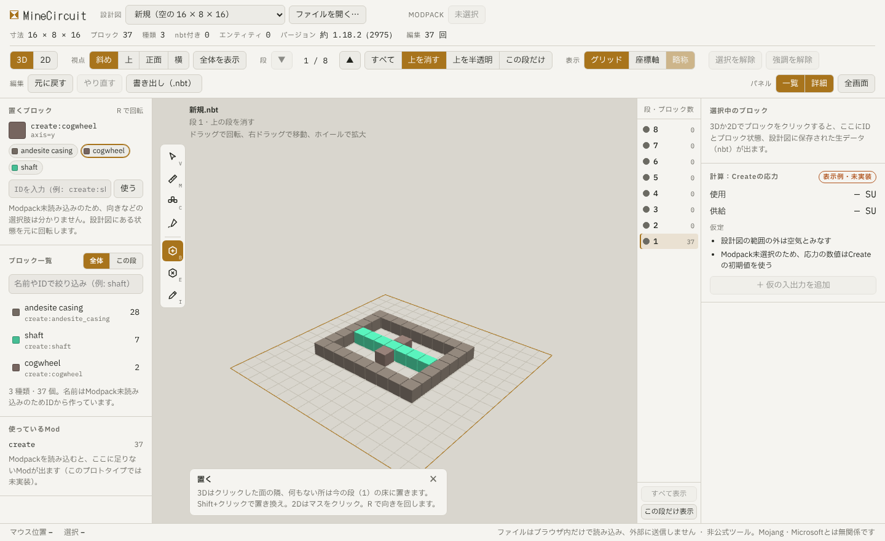

# MineCircuit

工業Mod（Createなど）の設計図を、ゲームの外で確認・編集・計算するアプリ。ブラウザ版と、Windows用のデスクトップ版（予定）がある。

- 設計図を3Dと2Dで表示し、1段ずつ中身を確認する
- ブロック数と寸法を数え、2点間の距離を測る
- ブロックを置く・消す・回転し、.nbt で書き出す
- Modpackのフォルダを読み込み、ブロック名の表示と足りないModの検出をする
- Modごとの計算プラグインで、応力などを計算する（予定）

ファイルは利用者のPCの中（ブラウザ版はブラウザ内）だけで処理し、外部に送信しない。デスクトップ版も通信しない。

デスクトップ版のインストーラーはコード署名をしていないため、Windowsが警告を出すことがある。

デスクトップ版は [GitHub のリリース](https://github.com/P0ngCh4ng/MineCircuit/releases) に置く（Windows 用の .msi と .exe）。自分でビルドするときは、Rust（rustup）と Visual Studio の C++ ビルドツールを入れて `npm install` のあと `npm run tauri:build` を実行する。

- 仕様: [docs/spec.md](docs/spec.md)
- クラス設計: [docs/design.md](docs/design.md)
- 画面構成: [docs/ui.md](docs/ui.md)
- UIプロトタイプ: [prototype/index.html](prototype/index.html)（ChromeかEdgeで開く）
- 開発ガイド（Claude Code 用）: [CLAUDE.md](CLAUDE.md)

## ライセンス

[MIT License](LICENSE)

## 注記

MineCircuit は非公式のツールです。Mojang Studios・Microsoft、および Create をはじめとする各Modの作者とは関係がなく、承認も受けていません。

NOT AN OFFICIAL MINECRAFT PRODUCT. NOT APPROVED BY OR ASSOCIATED WITH MOJANG OR MICROSOFT.

- Minecraft および各Modのテクスチャ・モデル・翻訳ファイルなどは、このリポジトリにもアプリにも含めません。アプリは、利用者のPCにあるファイルをその場で読み込むだけで、外部に送信しません。
- Minecraft は Mojang Synergies AB の商標です。各Modの名前・データの権利は、それぞれの作者に帰属します。
- 計算に使う各Modの初期値などをアプリに含める場合は、出典とライセンスをこのファイルに記載します。
  - Create の応力の初期値・回転数・ベルトの長さの上限・ボイラーと風車の段階（[docs/create-stress.md](docs/create-stress.md)、`src/calc/create/createDefaults.ts`・`createBeltConnector.ts`・`kineticGraph.ts`・`createRunning.ts`・`waterWheel.ts`）：[Create](https://github.com/Creators-of-Create/Create)（Copyright (c) The Create Team / The Creators of Create）と [Create Fabric](https://github.com/Fabricators-of-Create/create)（Copyright (c) 2019 simibubi）のソースコードから読み取った数値。どちらもコードは MIT License。Create のアセット（`src/main/resources/assets/`）は All Rights Reserved で、このアプリには含めません。
  - 液体の広がりと流れの向き（[docs/create-stress.md](docs/create-stress.md)「水車の水の流れ」、`src/calc/fluidFlow.ts`）：Minecraft 本体の液体の決まり（水は1マスごとに量が1減り、4マス先まで下へ落ちる所を探す。溶岩は2減り、2マス先まで。流れの向きの求め方）。ゲームの動きとして知られている決まりを、このアプリの言葉で書き直したもの。Minecraft のコードやデータは含めません。
  - Create のベルトとブレイズバーナーの部品のモデルの選び方（`src/io/assets/partialModels.ts`）：上と同じ Create・Create Fabric のソースコード（`BeltRenderer`・`BlazeBurnerRenderer`。MIT License）から、どの状態でどの部品のモデルをどの向きで描くかを読み取って書き直したもの。モデルとテクスチャそのものは含めず、利用者の jar から読みます。
  - チェストの絵の切り出し方（`src/io/assets/chestModel.ts`）：Minecraft 本体のチェストの絵（`textures/entity/chest/*.png`）の並び方を見て、どの範囲をどの面に貼るかを書いたもの。絵そのものは含めず、利用者の jar・リソースパックから読みます。
  - シュルカーボックスの絵の切り出し方（`src/io/assets/shulkerModel.ts`）：Minecraft 本体のシュルカーボックスの絵（`textures/entity/shulker/*.png`）の並び方を見て、どの範囲をどの面に貼るかを書いたもの。絵そのものは含めず、利用者の jar・リソースパックから読みます。
  - Custom Machinery の機械の見た目（`src/io/modpack/customMachinery.ts`、`src/io/assets/blockEntityAppearance.ts`）：機械の定義（データパックの `machines/*.json`）の `appearance.block` と、生データの `machineID` の形だけを使い、Modpack にある定義をその場で読みます。定義やモデルはアプリに含めません。
  - Create の輸送量と処理時間、物の動き（[docs/create-throughput.md](docs/create-throughput.md)、`src/calc/create/createThroughput.ts`・`createItemPath.ts`・`itemMotion.ts`・`fanCurrent.ts`・`mechanicalCrafter.ts`・`spoutDrain.ts`）：Create Fabric のソースコード（MIT License）の定数と規則（イジェクターの投げる道の式、トンネル・スパウト・ドレインの時間など）を読み取って書き直したもの。レシピは利用者の Modpack の jar と kubejs/data/ からその場で読み、kubejs/server_scripts/ のスクリプトはアプリの中の作り物の KubeJS で動かして集めます（外部には送りません）。どれもアプリには入れません。
  - Create の基本の部品の一覧（`src/calc/create/createBasicBlocks.ts`）：Modpack がないときの棚に出すブロックの ID と既定の状態。ID と状態の形は上と同じ Create・Create Fabric のソースコード（MIT License）から読み取ったもの。名前はアプリで書いたもので、Create の翻訳ファイルは使いません。
  - Create の歯車の設置規則と置き方の補助（`src/calc/create/createPlacement.ts`）：Create Fabric のソースコード（`CogWheelBlock.isValidCogwheelPosition`、`CogwheelBlockItem` の placement helper。MIT License）の規則を読み取って書き直したもの。
  - Create Crafts & Additions の電力の初期値と規則（[docs/createaddition-power.md](docs/createaddition-power.md)、`src/calc/createaddition/`）：[Create Crafts & Additions](https://github.com/mrh0/createaddition)（作者 MRH0 ほか）の jar（1.7.2 と Fabric 1.18.2 の 20230704a）のクラスファイルから読み取った設定の初期値（256 RPM のときの電力・応力、効率、接続と蓄電池の上限など）と、生データの形（電線の `nodes`）。コードは MIT License。jar・アセット・翻訳ファイルはこのアプリに含めず、利用者の Modpack からその場で読みます。
