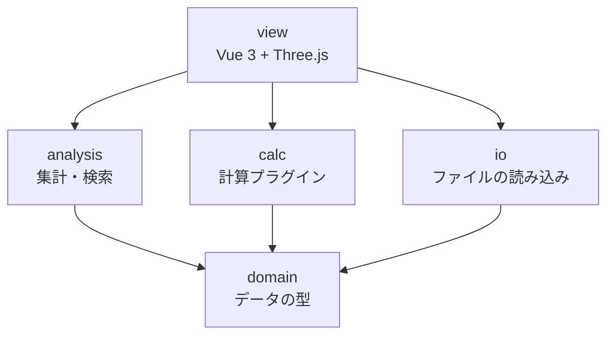

# MineCircuit クラス設計

作成日: 2026-10-19 / 仕様: [spec.md](spec.md)

TypeScriptで書く。コード例は設計を示すためのもので、細部は実装時に決める。

## 基本方針

1. **設計図ファイル1つだけで動く。** Modpack、設定ファイル、計算プラグインは、あればできることが増えるだけで、なくても動く。どの型でも `Modpack | null` のように「ない場合」を扱う。
2. **ファイルにあるものは全部、失わずに持つ。** 解釈できない項目も捨てない。後で使えるようにするためと、将来ファイルに書き戻すときに壊さないため。
3. **読み込みと解釈を分ける。** `Blueprint` / `BlockVolume` は「ファイルに何が入っているか」だけを表す。Modごとの意味づけ（回転のつながりなど）は計算プラグインの中で作る。
4. **値には出どころを付ける。** 計算に使った値が、設計図・Modpack・内蔵の初期値・仮定・仮の入出力のどれから来たかを記録し、結果に表示する。
5. **分からないものは「分からない」と扱う。** 推測で埋めた値は仮定として記録する。

## 層と依存の向き

依存は上から下への一方向だけ。下の層は上の層を知らない。



## domain：データの型

### ResourceLocation / BlockState

```ts
// "create:shaft" を namespace と path に分けて持つ
class ResourceLocation {
  constructor(readonly namespace: string, readonly path: string) {}
  static parse(s: string): ResourceLocation
  toString(): string
}

class BlockState {
  constructor(
    readonly id: ResourceLocation,
    readonly properties: Readonly<Record<string, string>>, // axis=y, facing=north など
  ) {}
}
```

### Blueprint

設計図ファイル1つ分。ファイルの情報と中身を持つ。

```ts
class Blueprint {
  constructor(
    readonly name: string,                       // ファイル名
    readonly format: 'nbt' | 'schem' | 'litematic',
    readonly dataVersion: number,                // Minecraftのバージョン判定に使う。2975 = 1.18.2
    readonly regions: BlockVolume[],             // .nbt と .schem は1つ、.litematic は複数ありうる
    readonly meta: BlueprintMeta,                // 作者・説明など。ない形式は空
  ) {}

  get size(): Vec3                               // 全リージョンを合わせた大きさ
  get namespaces(): Set<string>                  // 足りないModの検出に使う
  get(pos: Vec3): BlockState | null              // 設計図全体の座標で引く
  blockEntityAt(pos: Vec3): RawNbt | null
  neighbor(pos: Vec3, dir: Direction): BlockState | null  // 範囲外は null
  forEachInLayer(y: number, fn: (pos: Vec3, state: BlockState) => void): void
}

interface BlueprintMeta {
  author?: string
  description?: string
  createdAt?: Date
}
```

- 座標は設計図全体のもので、y が上下（段）。Minecraftと同じ。
- リージョンは最初から配列にする。今は `.nbt` だけで常に1つだが、単数で作ると `.litematic` 対応時に利用箇所を全部直すことになる。

### BlockVolume

1つのリージョンのブロック配置。読み込んだものを全部持つ。

```ts
class BlockVolume {
  readonly name: string                          // リージョン名。.nbt なら "main"
  readonly offset: Vec3                          // 設計図全体の中での位置
  readonly size: Vec3
  readonly palette: BlockState[]
  private readonly cells: Int32Array             // 位置ごとのパレット番号。空気は -1
  private readonly blockEntities: Map<number, RawNbt>  // セル番号 → ブロックエンティティの生データ
  readonly entities: RawEntity[]                 // 額縁、防具立てなど。生データのまま
  readonly extra: RawNbt                         // 解釈していない一番上の階層の項目

  get(x: number, y: number, z: number): BlockState | null
  blockEntityAt(x: number, y: number, z: number): RawNbt | null
}
```

- `cells` を型付き配列にするのは、数万ブロックの設計図でもメモリと速度を抑えるため。
- ブロックエンティティとエンティティは生データ（`RawNbt`）のまま持つ。中身の解釈は、必要になったModごとにプラグインで行う。
- `extra` には `Railways_DataVersion` のような、Modが足した知らない項目をそのまま入れる。

## io：読み込み

### FileSource

ファイルの読み方をここに閉じ込める。Tauriでデスクトップ版にするときは、ここだけ差し替える。

```ts
interface FileSource {
  list(dir: string): Promise<string[]>
  read(path: string): Promise<ArrayBuffer>
}

class BrowserFileSource implements FileSource { /* File System Access API */ }
```

### BlueprintReader

設計図の形式ごとに1クラス。最初は `.nbt` だけ。

```ts
interface BlueprintReader {
  canRead(fileName: string): boolean
  read(name: string, data: ArrayBuffer): Blueprint
}

class NbtBlueprintReader implements BlueprintReader {}
// 後で: SchemBlueprintReader, LitematicBlueprintReader
```

### Modpack / ModpackLoader

```ts
class ModpackLoader {
  constructor(private source: FileSource) {}
  load(): Promise<Modpack>   // mods/*.jar を開き、Mod情報と表示名を集める
}

class Modpack {
  readonly mods: ModInfo[]                                  // modId, 名前, バージョン
  hasNamespace(ns: string): boolean                         // jar の assets/ 以下のフォルダ名で判定
  displayName(id: ResourceLocation, lang: 'ja_jp' | 'en_us'): string | null
  config(path: string): Promise<string | null>              // 設定ファイルの中身。なければ null
}
```

- namespace と modId は一致しないModがあるため、`hasNamespace` は jar の `assets/<namespace>/` で判定する。
- jar から読むのは翻訳ファイル・モデル・ブロック状態の定義・テクスチャだけ。Javaのコードは実行しない。
- 読み込んだ表示名の一覧はブラウザ内に保存し、2回目以降を速くする。

## analysis：集計と検索

```ts
class BlueprintStats {
  constructor(private bp: Blueprint) {}
  countAll(): Map<string, number>
  countLayer(y: number): Map<string, number>
  bounds(): { min: Vec3; max: Vec3 }
}

class MissingModDetector {
  detect(bp: Blueprint, pack: Modpack): string[]   // 足りない namespace の一覧
}

class BlockSearch {
  find(bp: Blueprint, id: ResourceLocation): Vec3[]
}
```

## 値の出どころ

計算に使う値はどのModでも3種類に分かれる。

| 種類 | 例 | 出どころ（優先順） |
| --- | --- | --- |
| 個体の設定値 | クリエイティブモーターの回転数、速度コントローラーの設定 | ① 設計図の nbt → ② Modpackの初期値設定 → ③ 内蔵の初期値 |
| Modの定数 | 各ブロックの応力の消費量・供給量、回転数の上限 | ① Modpackの設定ファイル → ② 内蔵の初期値 |
| 構造から分かるもの | ベルトのつながり、シャフトの向き | ① ブロック状態 → ② nbt で補う |

```ts
type Provenance =
  | 'blueprint'   // 設計図の nbt やブロック状態から読んだ
  | 'modpack'     // Modpackの設定ファイルから読んだ
  | 'builtin'     // アプリ内蔵の初期値
  | 'virtual'     // 利用者が置いた仮の入出力
  | 'assumed'     // 情報がなく、アプリが仮定した

interface Resolved<T> {
  value: T
  source: Provenance
  note?: string   // 「範囲外は空気とみなした」など
}
```

優先順に値を探す処理と出どころの記録は共通部分に置く。各プラグインは「自分の内蔵の初期値」と「どこから値を引くか」の規則だけを書く。

## 設計図に入っていない情報

設計図ファイルはブロックとブロックエンティティの写しなので、次の情報は原理的に入らない。

| 種類 | 例 |
| --- | --- |
| ワールド全体に保存されるデータ | AE2のネットワーク、Createの線路網と列車、周波数でつながる送信機 |
| 設計図の範囲の外 | 範囲外の動力源や接続先 |
| 実行中にしかない状態 | 計算途中の値、組み立て中の仕掛け、毎tick再計算されるもの |
| 周りの環境 | バイオーム、明るさ、高度、天候 |

扱い方は2つ。

- **仮定（`assumed`）**：アプリが自動で置く。範囲外は空気とみなす、など。計算結果の仮定一覧に必ず載せる。
- **仮の入出力（`virtual`）**：利用者が意図して置く。下の `VirtualPort`。

## 仮の入出力（VirtualPort）

設計図の端のブロックの面に、利用者が仮の動力源や負荷を付けられる。計算では本物のブロックと同じように扱う。

```ts
interface VirtualPort {
  id: string
  pos: Vec3                       // 接続するブロックの位置
  face: Direction                 // どの面から入るか
  pluginId: string                // 'create-stress' など
  kind: string                    // 'rotation-source' など。種類はプラグインが定義
  params: Record<string, number>  // { rpm: 256, capacity: 4096 }
  label?: string                  // 「外の水車列」などのメモ
}
```

| プラグイン | 仮の入出力の例 |
| --- | --- |
| Createの応力 | 回転の供給（RPM、SU）、回転の消費（SU） |
| 電力系 | 電力の供給（FE/t）、電力の消費 |
| 生産量計算（将来） | アイテムの流入（個/分）、流体の流入（mB/秒） |

## calc：計算プラグイン

```ts
interface CalcPlugin {
  readonly id: string                          // 'create-stress'
  readonly portKinds: PortKindDef[]            // 受け付ける仮の入出力の種類。画面の入力欄に使う
  supports(bp: Blueprint, pack: Modpack | null): boolean
  run(bp: Blueprint, ctx: CalcContext): Promise<CalcResult>
}

interface CalcContext {
  pack: Modpack | null            // なければ内蔵の初期値で計算
  ports: VirtualPort[]            // このプラグイン宛ての仮の入出力
}

interface CalcResult {
  summary: { label: string; value: Resolved<string> }[]   // 「使用 2,048 SU / 供給 4,096 SU」
  issues: { pos: Vec3; message: string }[]                // 3D表示で強調する位置
  assumptions: { pos?: Vec3; message: string }[]          // 何を仮定して計算したか
}

class PluginRegistry {
  register(p: CalcPlugin): void
  available(bp: Blueprint, pack: Modpack | null): CalcPlugin[]
}
```

### 例：Createの応力プラグイン

```ts
class CreateStressPlugin implements CalcPlugin {
  async run(bp: Blueprint, ctx: CalcContext): Promise<CalcResult> {
    const values = new CreateValueResolver(CREATE_DEFAULTS, await CreateConfig.load(ctx.pack))
    const graph = KineticGraph.build(bp, ctx.ports)   // ブロックと向きから回転のつながりを作る
    return graph.evaluate(values)                      // ネットワークごとに供給と消費を比べる
  }
}
```

`KineticGraph` はCreate用に解釈したデータで、プラグインの中だけで使う。

## アプリ独自のファイル

仮の入出力やメモは `.nbt` に書き込めないので、設計図とは別のファイルに保存する。

```
distillery.nbt             ← 設計図（そのまま）
distillery.mcircuit.json   ← 仮の入出力、メモ、建築チェックリスト、表示の設定
```

```ts
interface ProjectFile {
  version: 1
  blueprint: string               // 設計図のファイル名
  ports: VirtualPort[]
  notes: { pos: Vec3; text: string }[]
  checklist: { layer: number; done: boolean }[]
}
```

最初の版で作るかは別として、置き場所だけ先に決めておく。

## view：画面

- `ViewState`（Piniaのストア）：今の段、段の表示方法（上を消す・半透明・この段だけ）、3D/2D の切り替え、強調するブロック
- `BlueprintMeshBuilder`：パレットの種類ごとに Three.js の InstancedMesh を1つ作る。ブロック数が多くても描画が軽い
- `LayerView2D`：選んだ段を canvas にマス目で描く

## 実物の .nbt で確認したこと

Create Astral（1.18.2）の設計図 `_.nbt`（8×1×4、23ブロック）と `[AstralExamples] Distillery.nbt` で確認した。

- 一番上の階層: `DataVersion`（2975）、`size`、`palette`、`blocks`、`entities`、`Railways_DataVersion`
- `palette` の各要素: `Name` と `Properties`（例: `create:cogwheel`、`axis: y`）
- `blocks` の各要素: `pos`、`state`（パレット番号）、`nbt`（ブロックエンティティの生データ。23個中16個が持つ）
- 歯車の `nbt`: `Speed`、`Source`（ワールド座標）、`Network`（`Size`、`Capacity`、`Stress` など）
- ベルトの `nbt`: `Controller`、`Length`、`Index`、載っているアイテム
- `Network` は保存時のワールドの状態で、設計図の外のブロックを含む（`Size: 26` に対して設計図内は23個）。計算結果には使わず、参考値として表示する程度にとどめる
- Distillery には `techreborn:`、`dbe:`、`custommachinery:` のブロックが含まれていた

## 未確認事項

- [ ] ベルトのブロック状態だけで、つながりを組み立てられるか
- [ ] クリエイティブモーターなど、個体の設定値の初期値（16 RPM は記憶で、未確認）
- [ ] Createの応力の数値が、ワールドごとの `serverconfig/create-server.toml` に入っているか
- [ ] Createのバージョンで、nbt の項目名が変わっていないか
