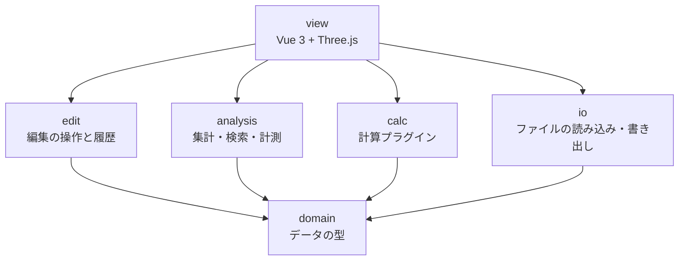
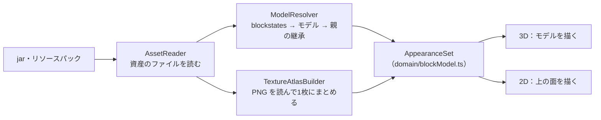

# MineCircuit クラス設計

作成日: 2026-10-19 / 更新: 2026-10-22（デスクトップ版を追加） / 仕様: [spec.md](spec.md)

TypeScriptで書く。コード例は設計を示すためのもので、細部は実装時に決める。

## 基本方針

1. **設計図ファイル1つだけで動く。** Modpack、設定ファイル、計算プラグインは、あればできることが増えるだけで、なくても動く。どの型でも `Modpack | null` のように「ない場合」を扱う。
2. **ファイルにあるものは全部、失わずに持つ。** 解釈できない項目も捨てない。後で使えるようにするためと、将来ファイルに書き戻すときに壊さないため。
3. **読み込みと解釈を分ける。** `Blueprint` / `BlockVolume` は「ファイルに何が入っているか」だけを表す。Modごとの意味づけ（回転のつながりなど）は計算プラグインの中で作る。
4. **値には出どころを付ける。** 計算に使った値が、設計図・Modpack・内蔵の初期値・仮定・仮の入出力のどれから来たかを記録し、結果に表示する。
5. **分からないものは「分からない」と扱う。** 推測で埋めた値は仮定として記録する。
6. **設計図の変更は、編集の操作を通してだけ行う。** 画面や計算プラグインが `BlockVolume` を直接書き換えない。こうすると、すべての変更が元に戻せる。

## 層と依存の向き

依存は上から下への一方向だけ。下の層は上の層を知らない。



## domain：データの型

### ResourceLocation / BlockState

```ts
// "create:shaft" を namespace と path に分けて持つ
class ResourceLocation {
  constructor(readonly namespace: string, readonly path: string) {}
  static parse(s: string): ResourceLocation
  toString(): string
}

class BlockState {
  constructor(
    readonly id: ResourceLocation,
    readonly properties: Readonly<Record<string, string>>, // axis=y, facing=north など
  ) {}
}
```

### Blueprint

設計図ファイル1つ分。ファイルの情報と中身を持つ。

```ts
class Blueprint {
  constructor(
    readonly name: string,                       // ファイル名
    readonly format: 'nbt' | 'schem' | 'litematic',
    readonly dataVersion: number,                // Minecraftのバージョン判定に使う。2975 = 1.18.2
    readonly regions: BlockVolume[],             // .nbt と .schem は1つ、.litematic は複数ありうる
    readonly meta: BlueprintMeta,                // 作者・説明など。ない形式は空
  ) {}

  get size(): Vec3                               // 全リージョンを合わせた大きさ
  get namespaces(): Set<string>                  // 足りないModの検出に使う
  get(pos: Vec3): BlockState | null              // 設計図全体の座標で引く
  blockEntityAt(pos: Vec3): RawNbt | null
  neighbor(pos: Vec3, dir: Direction): BlockState | null  // 範囲外は null
  forEachInLayer(y: number, fn: (pos: Vec3, state: BlockState) => void): void
}

interface BlueprintMeta {
  author?: string
  description?: string
  createdAt?: Date
}
```

- 座標は設計図全体のもので、y が上下（段）。Minecraftと同じ。
- リージョンは最初から配列にする。今は `.nbt` だけで常に1つだが、単数で作ると `.litematic` 対応時に利用箇所を全部直すことになる。

### BlockVolume

1つのリージョンのブロック配置。読み込んだものを全部持つ。

```ts
class BlockVolume {
  readonly name: string                          // リージョン名。.nbt なら "main"
  readonly offset: Vec3                          // 設計図全体の中での位置
  readonly size: Vec3
  readonly palette: BlockState[]
  private readonly cells: Int32Array             // 位置ごとのパレット番号。空気は -1
  private readonly blockEntities: Map<number, RawNbt>  // セル番号 → ブロックエンティティの生データ
  readonly entities: RawEntity[]                 // 額縁、防具立てなど。生データのまま
  readonly extra: RawNbt                         // 解釈していない一番上の階層の項目
  readonly alternatePalettes: RawNbt[][]         // palettes 形式の .nbt で、先頭より後ろのパレット（生データ）

  get(x: number, y: number, z: number): BlockState | null
  blockEntityAt(x: number, y: number, z: number): RawNbt | null

  // 編集用。呼ぶのは edit 層の操作だけ
  setCell(x: number, y: number, z: number, cell: CellValue): void
  cellAt(x: number, y: number, z: number): CellValue
  stateIndex(state: BlockState): number   // パレットになければ足す
}

// 1マス分の中身。空きは state = null
interface CellValue {
  state: BlockState | null
  blockEntity: RawNbt | null
}
```

- `cells` を型付き配列にするのは、数万ブロックの設計図でもメモリと速度を抑えるため。
- 編集でパレットに使われない状態が残っても、そのままにする。書き出し時に使っている状態だけでパレットを作り直す。
- ブロックエンティティとエンティティは生データ（`RawNbt`）のまま持つ。中身の解釈は、必要になったModごとにプラグインで行う。
- `extra` には `Railways_DataVersion` のような、Modが足した知らない項目をそのまま入れる。形式で決まった項目（.nbt なら `size`・`palette`・`palettes`・`blocks`・`entities`・`DataVersion`）は入れない。
- `palettes` 形式（パレットのリスト）の .nbt は先頭のパレットを使う。残りは `alternatePalettes` に生データのまま持ち、書き出しで戻す。並びは `palette` と同じ番号なので、編集で足した状態（末尾に足される）以外はそのまま対応する。

## io：読み込み

### FileSource

ファイルの読み方をここに閉じ込める。Tauriでデスクトップ版にするときは、ここだけ差し替える。

```ts
interface FileSource {
  list(dir: string): Promise<string[]>
  read(path: string): Promise<ArrayBuffer>
  stat?(path: string): Promise<{ size: number; lastModified: number } | null>   // 変わった jar だけ読み直すため。なくてもよい
  readRange?(path: string, start: number, end: number): Promise<ArrayBuffer>    // ファイルの一部だけ。jar の必要な部分だけを読むため。なくてもよい
}

// 保存先。ブラウザでは保存先を選ぶ画面、Tauri版ではファイルに直接書く
interface FileSink {
  save(suggestedName: string, data: Uint8Array): Promise<'saved' | 'cancelled'>
}

class BrowserFileSource implements FileSource { /* File System Access API */ }
class BrowserFileSink implements FileSink { /* showSaveFilePicker */ }
class TauriFileSource implements FileSource { /* @tauri-apps/plugin-fs。デスクトップ版。readRange は open + seek + read */ }
class TauriFileSink implements FileSink { /* @tauri-apps/plugin-dialog の save + plugin-fs の writeFile */ }
```

#### デスクトップ版（Tauri）

デスクトップ版は、ブラウザ版の画面をそのまま Tauri 2 で包む。違うのはファイルの読み書きだけで、`FileSource` / `FileSink` とその周り（Modpack の登録、設計図を開く・保存する）を差し替える。

| 部分 | ブラウザ版 | デスクトップ版 |
| --- | --- | --- |
| Modpack のフォルダ | `BrowserFileSource`（フォルダのハンドル） | `TauriFileSource`（フォルダのパス） |
| 登録の保存 | IndexedDB にハンドルを保存。許可が切れたら出し直す | IndexedDB にパスを保存。次回も許可なしで読む |
| 設計図を開く | `<input type="file">` とドラッグ&ドロップ | ファイルを選ぶ画面は Tauri のダイアログ（`pickTauriBlueprintFile`）。ドラッグ&ドロップは同じ |
| 保存 | `BrowserFileSink`（保存先を選ぶ画面。なければダウンロード） | `TauriFileSink`（保存先を選ぶ画面で選んだパスに書く） |
| 表示名の保存 | IndexedDB | 同じ（WebView2 の IndexedDB） |

- **どちらで動いているかの判定は view の1か所だけ**（`view/platform/`）で行い、そこで実装を選んでストアに渡す。io・edit・analysis・calc は、どちらで動いているかを知らない。実装を選ぶ関数は `view/platform/fileAccess.ts`（`createBlueprintSink`、`loadDesktopModpackFolders`、`pickDesktopBlueprintFile`、画面の注意書きの `fileHandlingNotice`）。io/tauri/ はここから動的 import で読む。
- **`TauriFileSource` などは `src/io/tauri/` に置く。** Tauri の API（`@tauri-apps/*`）を import してよいのは、`src/io/tauri/` と `view/platform/` だけにする。ブラウザ版のビルドにも入るが、動的 import で読み、ブラウザでは呼ばない。Lint の決まりに足す。
- **Modpack の登録**は、今の `ModpackRegistry<H>` のハンドルの型 `H` をパス（`string`）にして使う（`io/tauri/tauriModpackRegistry.ts`）。`ModpackHandleOpener` の実装を Tauri 用に足すだけで、登録の一覧や画面は変えない。保存先は `IndexedDbModpackStore<H>`（`io/modpack/indexedDbModpackStore.ts`）で、ブラウザ版（`minecircuit-modpacks`）と名前を分けて `minecircuit-modpacks-desktop` に入れる。
  - 開くときは、まずフォルダの一覧を読んで確かめる。読む許可の範囲の外（persisted-scope の記録が消えた、など）なら `needs-permission` にし、「フォルダを読む許可を出す」で同じフォルダを選び直してもらう（選ぶと Tauri が範囲を足し直す）。別のフォルダを選んだら開かない。フォルダが消えていれば、そのパスを書いたエラーにする。
- **読む許可の範囲**：Tauri の fs プラグインは、許可した場所しか読めない。利用者がダイアログで選んだフォルダだけを許可し、`tauri-plugin-persisted-scope` で次回も同じ範囲を許可する。読み込みは選んだフォルダの中だけ、書き込みは保存の画面で選んだファイルだけにする。
- **jar の読み方**：`FileSource` の任意の `readRange?(path, start, end)` と `stat` の両方があれば、zip の末尾（ファイルの一覧）と必要な項目だけを読む（`io/modpack/partialZip.ts`。下の「Modpack / ModpackLoader」）。`TauriFileSource`（open + seek + read）、`BrowserFileSource` と `<input webkitdirectory>` のファイル（どちらも `File.slice`）が持つ。どちらでも結果は丸ごと読んだときと同じ。
- **Rust 側**（`src-tauri/`）には、Tauri の起動と、公式プラグイン（fs、dialog、persisted-scope）の登録と、許可（capabilities）の設定だけを書く。独自のコマンドは作らない。処理を Rust に書くと、ブラウザ版と動きがずれ、Vitest でテストできなくなるため。
- **許可しない操作**：ネットワーク、シェル、自動更新。CSP でも外部への通信を止める。

許可の一覧（`src-tauri/capabilities/default.json`。メインウィンドウだけ）:

| 許可 | 使いみち |
| --- | --- |
| `core:default` | Tauri の基本（ウィンドウ・イベント・パスなどの読み取り）。通信やファイルの許可は含まない |
| `dialog:allow-open`・`dialog:allow-save` | ファイル・フォルダを選ぶ画面と、保存先を選ぶ画面。メッセージの画面は使わない |
| `fs:allow-read-file`・`fs:allow-read-dir`・`fs:allow-stat`・`fs:allow-exists` | 選んだフォルダ（Modpack）と選んだファイルを読む |
| `fs:allow-open`・`fs:allow-read`・`fs:allow-seek` | jar の一部だけを読む（開く・位置を移す・読む）。開くのは読むためだけ（`read: true`）。閉じるのは `core:default` に入っている |
| `fs:allow-write-file` | 保存の画面で選んだファイルに書く |

- fs の許可には固定の範囲（`$HOME` など）を付けない。範囲は、dialog プラグインが利用者の選んだパスを実行中に足すものだけになる。フォルダを選ぶときは `recursive: true` を渡して中まで読めるようにし、persisted-scope がその範囲を次回も残す。
- fs の範囲は読み書きで分かれていないので、選んだフォルダにも書けてしまう。書き込みは `TauriFileSink` が保存の画面で選んだパスにだけ行う、とコードで守る。
- CSP（`src-tauri/tauri.conf.json`）は、自分のファイル（`'self'`）と Tauri の内部の通信（`ipc:`・`http://ipc.localhost`）と `blob:`・`data:` だけを許す。外部の URL への通信・読み込みはすべて止まる。Vue の静的な部分が `style` 属性を使うため、`style-src` だけ `'unsafe-inline'` を許し、Tauri がそこに nonce を足さないようにしている（`dangerousDisableAssetCspModification`）。開発中（`devCsp`）は Vite の更新通知（`ws://localhost:5173`）も許す。
- ウィンドウのドラッグ&ドロップは Tauri ではなくページに渡す（`dragDropEnabled: false`）。ブラウザ版と同じ方法で設計図を開けるようにするため。

### BlueprintReader

設計図の形式ごとに1クラス。最初は `.nbt` だけ。

```ts
interface BlueprintReader {
  canRead(fileName: string): boolean
  read(name: string, data: ArrayBuffer | Uint8Array): Promise<Blueprint>   // gzip の展開が非同期のため
}

class NbtBlueprintReader implements BlueprintReader {}
// 後で: SchemBlueprintReader, LitematicBlueprintReader
```

.nbt の読み込みの規則:

- 空気（`minecraft:air`・`cave_air`・`void_air`）は置かれていないもの（-1）にする。パレットには残すので、パレット番号はファイルと同じになる。Create の設計図は空気を保存しない（`blocks` に入らない）ので、これで失うものはない。バニラの構造ブロックの .nbt は空気を明示して保存するが、その区別（空気で上書きするか、そのままにするか）は残らない
- `DataVersion` がないファイルは `dataVersion = 0`（`UNKNOWN_DATA_VERSION`）にする。書き出しでは 0 なら `DataVersion` を書かない
- 形式が違うときは、何が足りないか・どこが違うかを書いた `BlueprintReadError` を出す

### BlueprintWriter

読み込みの逆。形式ごとに1クラス。最初は `.nbt` だけ。

```ts
interface BlueprintWriter {
  readonly format: 'nbt' | 'schem' | 'litematic'
  write(bp: Blueprint): Promise<Uint8Array>   // gzip 済み
}

class NbtBlueprintWriter implements BlueprintWriter {}
```

書き出しの規則:

- 一番上の階層は、読み込んだときの生データ（`extra`）を元にする。`size`・`palette`・`blocks` だけを作り直し、`entities`・`DataVersion`・Modが足した項目はそのまま残す
- パレットは、使っている状態だけで作り直す
- 既存ブロックの生データ（nbt）はそのまま書く。新しく置いたブロックには書かない
- 書き出した直後に読み直し、ブロックの配置と状態が元と一致するか確かめる。一致しなければ保存しない
- 新規作成の設計図は `DataVersion` を持たないので、対象のModpackのバージョンから決める。Modpackがなければ利用者に選んでもらう
  - 新規作成の画面で Minecraft のバージョンを選び、その正式版の `DataVersion` を設計図に入れる（`domain/minecraftVersion.ts` の一覧）。書き出しではそれを書く
  - Modpack があれば、jar の名前と Mod のバージョンに一番多く出てくる Minecraft のバージョンを最初に選んでおく（`io/modpack/minecraftVersionGuess.ts`）。jar にはバージョンを確実に書いた場所がないため推定にとどめ、利用者が選び直せる
  - `DataVersion` のない .nbt はゲームが古い版のデータとして変換しようとするので、新規作成ではバージョンを選ぶまで作らない

### Modpack / ModpackLoader

```ts
class ModpackLoader {
  constructor(private source: FileSource) {}
  load(): Promise<Modpack>   // mods/*.jar を開き、Mod情報と表示名を集める。resourcepacks/ と ModTranslations/ の翻訳も重ねる
}

class Modpack {
  readonly mods: ModInfo[]                                  // modId, 名前, バージョン
  hasNamespace(ns: string): boolean                         // jar の assets/ 以下のフォルダ名で判定
  displayName(id: ResourceLocation, lang: 'ja_jp' | 'en_us'): string | null
  config(path: string): Promise<string | null>              // 設定ファイルの中身。なければ null
  blockStateDefinition(id: ResourceLocation): JsonValue | null   // blockstates/<path>.json。回転の候補に使う
  blockIds(): string[]                                      // blockstates のあるブロックの ID（名前順）。置くブロックの検索に使う
  assets(): AssetReader                                     // 見た目の資産（models・blockstates・textures）を読む。下の「見た目」
  readonly vanilla: VanillaStatus | null                    // Minecraft 本体の jar を見つけたか。下の「Minecraft 本体の資産」
}
```

- namespace と modId は一致しないModがあるため、`hasNamespace` は jar の `assets/<namespace>/` で判定する。KubeJS のスクリプトで登録したブロックの namespace も足す（下の「KubeJS が足すブロック」）。
- jar から読むのは翻訳ファイル・モデル・ブロック状態の定義・テクスチャだけ。Javaのコードは実行しない。
- 読み込んだ表示名の一覧はアプリ内（IndexedDB）に保存し、2回目以降を速くする。jar ごとに、ファイル名・大きさ・更新時刻を鍵にして IndexedDB に保存し、変わった jar だけ読み直す。
- jar を開く処理（zip の展開と JSON の解釈）は Web Worker で行う。`ModpackLoader` は開く関数を差し替えられるので、テストでは Worker なしで動く。
- jar の必要な部分だけを読む（`FileSource` に `readRange` と `stat` があるとき。`io/modpack/partialZip.ts`）：
  - 末尾の 64KB ほど（ファイルの一覧の場所を書いた目印と zip64 の目印）→ ファイルの一覧 → 欲しい項目（Mod の情報、翻訳、ブロック状態の定義、jar の中の jar）の順に、その範囲だけを読む。項目は並んで入っているので、項目の終わりは次の項目の始まりで決める。間が 64KB 以下の項目はまとめて1回で読み、読む回数を減らす。
  - ファイルを読むのは画面側（Tauri のファイルの読み書きは Worker から呼べない）。読んだものは圧縮されたまま（`ExtractedZip`：すべての項目の名前と、欲しい項目の圧縮されたバイト列）Worker へ移し（コピーしない）、Worker で展開と JSON の解釈を行う。Worker へ渡すものは `JarContent`（ファイル全体の `zip` か、取り出した `entries`）。
  - 結果は fflate の `unzipSync` で丸ごと読んだときと同じになるよう、fflate と同じ読み方をする（zip64、名前の文字コード、末尾のコメントを含む）。想定と違う形（zip でない、zip の前に余計なデータがある、読めたバイト数が足りない、など）なら、丸ごと読む方法に戻す。壊れた jar のお知らせは、丸ごと読んだときと同じ文になる。
  - 保存の鍵（大きさと更新時刻）と IndexedDB への保存は、丸ごと読むときと同じ。
- `minecraft` の namespace は jar になくても、常にあるとみなす。本体の翻訳・ブロック状態の定義・資産は、Minecraft 本体の jar を見つけたときだけ読む（下の「Minecraft 本体の資産」）。見つからなければ、リソースパックが足していない限り本体のブロックの表示名は出ない。

#### Minecraft 本体の資産

バニラ（`minecraft:`）のブロックは mods/ にないので、Minecraft 本体の jar（クライアントの jar）を読む（`io/modpack/vanillaAssets.ts`）。本体の jar はアプリにもリポジトリにも入れず、利用者の PC にあるものをその場で読む。

本体の jar は、ランチャーごとに置き場所が違い、多くは Modpack のフォルダの外にある。ここでは versions/・libraries/・assets/ のあるフォルダを「ゲームのフォルダ」と呼ぶ。

| ランチャー | Modpack のフォルダ | ゲームのフォルダ | 本体の jar | 資産の索引の id |
| --- | --- | --- | --- | --- |
| 公式ランチャー | `.minecraft`（起動の構成でゲームのフォルダを分けたときはそのフォルダ） | `.minecraft` | `versions/<版>/<版>.jar` | `versions/<版>/<版>.json` の `assetIndex.id` |
| CurseForge | `curseforge/minecraft/Instances/<名前>` | `curseforge/minecraft/Install`（すべてのプロファイルで共有） | 同上 | 同上 |
| Modrinth App | `ModrinthApp/profiles/<名前>` | `ModrinthApp/meta` | 同上。Mod ローダーを使う版は `versions/<版>-<ローダー>/<同じ名前>.jar` | 同上 |
| Prism Launcher / MultiMC | `instances/<名前>/.minecraft` | ランチャーのフォルダ | `libraries/com/mojang/minecraft/<版>/minecraft-<版>-client.jar` | `meta/net.minecraft/<版>.json` の `assetIndex.id` |

- **版を決める。** Modpack のフォルダのランチャーの情報（CurseForge の `minecraftinstance.json` の `gameVersion`、Modrinth App の古い `profile.json` の `metadata.game_version`）→ Mod の jar の名前とバージョンからの推定（`minecraftVersionGuess.ts`）の順。どちらでも分からなければ、ゲームのフォルダにある版が1つだけのときにそれを使う。
- **探す順。** Modpack のフォルダ（公式ランチャーで `.minecraft` を選んだとき）→ 利用者が選んだゲームのフォルダ（選んだ順）。各フォルダで、上の表の jar の場所と、フォルダの一番上の `<版>.jar`・`minecraft-<版>-client.jar`（版のフォルダそのものを選んだとき）を探す。FileSource は選んだフォルダの外を読めないので、Modpack のフォルダから `../../Install` のようにたどることはしない。
- **ゲームのフォルダを選んでもらう。** 見つからなければ、Modpack の画面に「Minecraft 本体のフォルダを選ぶ」を出す。選んだフォルダは Modpack の登録と同じ方法で保存する（ブラウザ版はフォルダのハンドルを IndexedDB の `minecircuit-game-folders`、デスクトップ版はパスを `minecircuit-game-folders-desktop`。`io/modpack/gameFolderRegistry.ts`）。1つのフォルダをすべての Modpack で使う。versions/・libraries/・assets/ も jar もないフォルダは足さない。ブラウザ版で許可が切れていたら「本体のフォルダを読む許可を出す」で出し直す。デスクトップ版は、選ぶ画面を、選んでいる Modpack のフォルダから割り出したゲームのフォルダで開く（`guessGameFolderPath`。上の表のとおり、CurseForge の `Instances/<名前>` なら `Install`、Modrinth App の `profiles/<名前>` なら `meta`、Prism Launcher・MultiMC の `instances/<名前>/.minecraft` ならランチャーのフォルダ）。初めの場所を変えるだけで、読む許可は利用者が選んだフォルダにしか足さない。ブラウザ版のフォルダを選ぶ画面は、初めの場所にパスを渡せないので変えない。デスクトップ版は選んだときに読む範囲が足され、persisted-scope が次回も残す（許可の設定は変えない）。
- **読み方。** 本体の jar は Mod の jar と同じ読み方（部分読み、Worker の `scanJar`、IndexedDB の保存。鍵は `minecraft|<jar のパス>` と大きさ・更新時刻）。見た目の資産を持たない jar（中身の違うもの）は使わず、次の場所を探す。読めない jar は `Modpack.problems` に書いて次の場所を探す。見つからなくてもエラーにはせず、本体のブロックを色付きの箱で描き、名前を出さない。
- **優先度。** 本体の翻訳・ブロック状態の定義・資産は、どの jar よりも優先度が低い（Mod やリソースパックが本体のテクスチャを差し替えていれば、そちらを使う）。Mod の一覧・namespace・jar の数には足さない。`hasNamespace('minecraft')` はこれまでどおり常に true。ブロック状態の定義を足すので、置くブロックの検索（`blockIds()`）にも本体のブロックが出る。
- **日本語の名前。** 本体の jar の翻訳は `en_us.json` だけで、ほかの言語はランチャーが資産としてダウンロードし、ハッシュの名前で置く。ゲームのフォルダの `assets/indexes/<id>.json`（id は上の表。版の情報がなければ `<版>.json`・`<1.xx>.json` を試す）の `objects["minecraft/lang/ja_jp.json"].hash` から、`assets/objects/<ハッシュの先頭2文字>/<ハッシュ>` を読む。中身はハッシュで決まるので、ハッシュを鍵にして名前だけを IndexedDB に保存する。ランチャーは索引にある資産（全言語の翻訳を含む）をまとめてダウンロードするので、日本語を選んだことがなくても多くはある。なければ英語の名前だけになり、画面にそう書く。1.12 以前の `.lang` 形式の翻訳は読まない。
- 画面（`view/VanillaAssetsStatus.vue`、`view/stores/gameFolders.ts`）は、見つけた版と場所、日本語の名前を読めたか、選んだフォルダの一覧を出す。選んだフォルダが変わると、Modpack を読み直す。

#### jar の外の翻訳

Modpack によっては、jar の外で Mod の翻訳を足している。`ModpackLoader` は jar のあとに次の場所も読み、`assets/<namespace>/lang/` の `ja_jp.json` と `en_us.json`（大文字小文字は問わない）から名前のキーだけを取り出す（`io/modpack/langPacks.ts`）。

| 場所 | 形 |
| --- | --- |
| `resourcepacks/*.zip` | zip のリソースパック |
| `resourcepacks/<フォルダ>/` | フォルダのリソースパック |
| `ModTranslations/` | `assets/<namespace>/lang/` を持つフォルダ（pack.mcmeta はない） |
| `kubejs/` | `kubejs/assets/<namespace>/` を持つフォルダ（KubeJS が足したブロックの翻訳と資産。下の「KubeJS が足すブロック」） |

- 同じキーがあれば、優先度の高いものを使う。低い順に、jar（名前順） < `kubejs/` < `ModTranslations/` < `resourcepacks/` のうち `options.txt` に書いていないもの（名前順） < `options.txt` の `resourcePacks` に書いてあるもの（書いてある順。後ろほど優先。ゲームと同じ）。
- `options.txt` で有効になっていないパックも読む。Modpack が別の Mod（Global Packs など）でパックを有効にしていることがあり、どれが有効かを確実には決められないため。表示名にだけ使うので、外れても困ることは少ない。
- 表示名の言語の順（日本語 → 英語）はこれまでどおり。リソースパックの英語名が jar の日本語名に勝つことはない。
- リソースパックは Mod ではないので、`hasNamespace`・ブロック状態の定義・Mod の一覧には足さない。
- zip のリソースパックは jar と同じ読み方（Worker の `scanJar`、IndexedDB の保存）を使う。保存の鍵はパス（`resourcepacks/foo.zip`）にして jar と分け、保存する前に翻訳以外を捨てる。フォルダは翻訳ファイルだけを直接読む（数が少ないので保存しない）。
- 読めないパックや翻訳ファイルは `Modpack.problems` に入れ、ほかは読み続ける。翻訳を読んだ場所の一覧は `Modpack.langPacks`。

#### KubeJS が足すブロック

Modpack によっては、jar ではなく KubeJS のスクリプトでブロックを登録している（Create Astral の `createastral:` など）。jar の `assets/` にない namespace なので、そのままでは足りない Mod と判定してしまう（`io/modpack/kubejs.ts`）。

- `kubejs/startup_scripts/` の `.js`（下のフォルダも含む）から、`.create("<namespace>:<path>")` の形の呼び出しを探し、その namespace を `hasNamespace` と `Modpack.namespaces` に足す。スクリプトは実行しない。namespace のない ID（`kubejs:` になる）は数えない（KubeJS の jar が `kubejs` を持つ）。
- 文字列で探すだけなので、変数で組み立てた ID は拾えない。また、スクリプトが既存の Mod の namespace（`create:` など）で登録していれば、その Mod の jar がなくても「ある」とみなす。
- `kubejs/assets/` は、フォルダのリソースパックと同じく翻訳と見た目の資産を読む（上の「jar の外の翻訳」）。
- **ブロックの形。** KubeJS はブロックの blockstates とモデルをゲームの中でスクリプトから組み立てるので、`kubejs/assets/` に `blockstates/` がないことが多い。同じものをこちらで組み立てる（`kubeJsBlockAssets`）。
  - ブロックの登録のイベント（1.18 の `onEvent('block.registry', …)`、1.19.2 からの `StartupEvents.registry('block', …)`）の中の `.create("<id>"[, "<種類>"])` を探し、次の `.create(` までを、そのブロックの設定とみなす。アイテムなど、ほかのイベントの `.create` は読まない。
  - 種類が `basic` か省略のもの（立方体）だけを組み立てる。slab・stairs・wall などは形が違うので組み立てず、これまでどおり箱で描く。`.box(…)` の形も読まない。
  - テクスチャは `<ns>:block/<path>` を既定にして、`.textureAll(…)` と `.texture("<面>", …)` を書いた順に当てる。`.model(…)` があれば blockstates はそのモデルを指し、モデルは組み立てない。
  - 6面が同じなら `block/cube_all`、違えば `block/cube` を親にしたモデルにする（どちらも内蔵のバニラの親で読める）。particle は北の面。blockstates は状態なし（`""`）。
  - 組み立てた資産は、jar より優先度が高く、`kubejs/` のフォルダより低い場所（`ModpackAssetReader` の `memory`）に置く。`kubejs/assets/` に本物のモデルがあれば、そちらを使う。組み立てた blockstates はブロック状態の定義にも入れるので、置くブロックの検索にも出る。
  - 文字列で探すだけなので、変数やループで組み立てた ID とテクスチャは拾えない。

## analysis：集計と検索

```ts
class BlueprintStats {
  constructor(private bp: Blueprint) {}
  countAll(): Map<string, number>              // ID ごとの数。properties は区別しない。多い順
  countLayer(y: number): Map<string, number>
  bounds(): { min: Vec3; max: Vec3 } | null    // ブロックのある範囲。1つもなければ null
  totals(): BlueprintTotals                    // ブロック数、種類、nbt 付き、エンティティ（上のバー）
}

class MissingModDetector {
  detect(bp: Blueprint, pack: Modpack): string[]   // 足りない namespace の一覧
}

class BlockSearch {
  find(bp: Blueprint, id: ResourceLocation): Vec3[]
}
```

## analysis：計測

```ts
interface Measurement {
  a: Vec3
  b: Vec3
  delta: Vec3                 // b - a
  euclidean: number           // 直線距離
  manhattan: number           // 軸に沿った距離。シャフトやベルトを引く長さの目安
  boundingSize: Vec3          // 2点を囲む範囲
}

function measure(a: Vec3, b: Vec3): Measurement
function floodSameState(bp: Blueprint, start: Vec3): Vec3[]   // 隣り合う同じ種類のブロック
```

`floodSameState` は「つながり」ツールで使う。回転や配管のつながりではないので、画面にもそう書く。本当のつながりは計算プラグインが作る（`KineticGraph` など）。

## edit：編集の操作と履歴

### 操作

すべての変更を操作（コマンド）として表す。操作は「どのマスが、何から何に変わったか」の一覧を持つので、元に戻すのもやり直すのも同じ形で扱える。

```ts
interface CellChange {
  pos: Vec3
  before: CellValue
  after: CellValue
}

interface EditCommand {
  readonly label: string              // 「shaft を置く」。元に戻すボタンのツールチップに出す
  readonly changes: CellChange[]
}

// 操作を作る関数。Blueprint は変えず、変更の一覧だけを返す
function placeBlock(bp: Blueprint, pos: Vec3, state: BlockState, replace: boolean): EditCommand | null
function eraseBlock(bp: Blueprint, pos: Vec3): EditCommand | null
function rotateBlock(bp: Blueprint, pos: Vec3, vertical: boolean): EditCommand | null
// 生データの項目 key を tag にする。生データがなければ initial の写しから作る
function setBlockEntityTag(bp: Blueprint, pos: Vec3, key: string, tag: NbtTag, initial: RawNbt | null, label: string | null): EditCommand | null
// 範囲の操作は下の「範囲の編集」
```

- 新しく置いたブロックは `blockEntity: null`。計算では値の出どころの仕組みで初期値を使う
- 回転では生データ（nbt）をそのまま引き継ぐ
- 生データの項目を変える操作は、元の生データを書き換えず、写しを作って項目だけを差し替える。元に戻すと元の生データ（同じもの）を書き戻す。どのブロックのどの項目を変えられるか、生データがないときに何を入れるかは、Mod ごとの知識なので calc に置く（`calc/blockSettings.ts` の `blockSettingsFor`）。画面はそれを表示するだけ
- 置くツールで範囲の外へ置くことは受け付けない。設計図を広げるのは範囲の操作（動かす・回す・貼り付け）だけ

### 範囲の編集（#129）

画面の操作は [ui.md](ui.md)「範囲の選択と一括操作」。

**選択範囲は画面の状態。** 選択範囲（`SelectionBox`：最小と最大の角）は view のストアが持つ。edit の操作は箱を引数で受け取るだけで、選択を覚えない。

```ts
interface Box { min: Vec3; max: Vec3 }                // 両端を含む。domain/box.ts

// 変換（domain/blockTransform.ts）。pivot のまわりで先に反転し、次に回し、最後に translate だけ動かす。
// マス p の行き先は pivot + 回転(反転(p − pivot)) + translate。ゲームが設計図を置くときと同じ順（反転 → 回転）
interface BlockTransform {
  translate: Vec3
  quarterTurns: 0 | 1 | 2 | 3                         // 上から見て右回りに 90° ずつ（north → east）
  mirror: 'none' | 'x' | 'z'                          // 'x' は x を逆に（east ↔ west）、'z' は z を逆に（north ↔ south）
  pivot: Vec3                                         // 回転・反転の軸のマス
}

// 範囲の操作を作る関数。Blueprint は変えず、操作だけを返す
function eraseRegion(bp: Blueprint, box: Box): EditCommand | null
function fillRegion(bp: Blueprint, box: Box, state: BlockState, onlyEmpty: boolean): EditCommand | null
function replaceInRegion(bp: Blueprint, box: Box, from: BlockState, to: BlockState, keepOrientation: boolean): EditCommand | null
function transformRegion(bp: Blueprint, box: Box, t: BlockTransform, opts: TransformOptions): RegionEditResult
function pasteClip(bp: Blueprint, clip: BlueprintClip, at: Vec3, t: BlockTransform, opts: TransformOptions): RegionEditResult

interface TransformOptions {
  overwrite: boolean                                  // 行き先のブロックを上書きするか
  blockEntity?: BlockEntityTransformer                // 生データの中の座標を書き直す（下）。省略なら生データはそのまま
  states?: StateTransformer                           // ブロック状態の向きを回す・反転する（下）。省略ならバニラの規則
}

// 作れなかったときは理由。作れたときは操作と、動いた先の範囲
type RegionEditResult =
  | { ok: true; command: EditCommand; box: Box; warnings: string[] }
  | { ok: false; reason: string }

// 切り抜き。範囲の最小の角からの相対位置で持つ。空きマスは持たない
interface BlueprintClip {
  size: Vec3
  cells: { pos: Vec3; cell: CellValue }[]
  entities: RawEntity[]                               // 位置は切り抜きの中の相対位置に直したもの
  dataVersion: number
}
function copyRegion(bp: Blueprint, box: Box): BlueprintClip
```

**操作の形を広げる。** 今の `EditCommand` はマスの変更だけを持つ。範囲の操作のために、設計図の大きさとエンティティの変更も持てるようにする。

```ts
interface EditCommand {
  readonly label: string
  readonly changes: CellChange[]
  readonly resize?: RegionResize[]                    // 先に大きさを変えてから changes を書く。元に戻すときは逆
  readonly entities?: EntityChange[]
}

interface RegionResize {
  region: number                                      // Blueprint.regions の番号
  before: { offset: Vec3; size: Vec3 }
  after: { offset: Vec3; size: Vec3 }
}

interface EntityChange { region: number; before: RawEntity[]; after: RawEntity[] }  // リージョンのエンティティを丸ごと差し替える
```

- `RegionResize` は、設計図全体の座標のずれ `shift`（負の向きに広げたとき。どのリージョンでも同じ値）も持つ。リージョンの中身は、リージョンの中の座標で `before.offset + shift − after.offset` だけずれる。
- `BlockVolume` に `resize(offset, size, shift)` を足す。中身の配列を作り直し、中身を `shift` だけずらして写す。エンティティは変えない（`setEntities` で別に差し替える）。呼んでよいのは `setCell` と同じく edit の `EditHistory` だけ。
- `changes` の位置は、大きさを変えたあとの座標。
- 負の向きにはみ出すときは、全リージョンの `offset` をずらして最小を 0 にする（位置か大きさが変わるリージョンの分だけ `RegionResize` を持つ）。
- 大きさの上限は各辺 512。

**範囲を動かす・回す・反転する（#131・#132）。** `transformRegion(bp, box, t, opts)`（`edit/regionTransform.ts`）。動かすのは `moveRegion`（平行移動だけの `transformRegion`）。

- 回す：範囲の中心のマス（中心が2つのマスの間なら小さい側）を `pivot` にする（`rotationAbout`）。
- 反転：範囲の中で写す（`mirrorWithin`）。幅が偶数だと中心のマスでの反転は1マスずれるので、`translate` で範囲に戻す。

- 範囲は1つのリージョンの中にあること（またがるなら断る）。行き先がリージョンの外なら、そのリージョンを広げる。広げた所がほかのリージョンに重なるなら断る。
- 範囲の中の空きも写す（行き先は範囲の写しになる）。行き先にある範囲の外のブロックの数を数え、`overwrite` でなければ断る。
- エンティティは、ブロックの位置（`blockPos`、なければ `pos`）が範囲の中なら一緒に変換する。`pos` はマスの中心が行き先のマスの中心に移るように、`blockPos` はマスとして変換し、壁掛けの物（額縁・絵）の `nbt` の `TileX`・`TileY`・`TileZ` は `blockPos` の動いた分だけ直す。`nbt` の `Pos` はゲームが置くときに `pos` から作り直すのでそのまま。リージョンの中身がずれるときは、範囲の外のエンティティもその分だけ直す。
- 回転・反転では、エンティティの向きも変える。`nbt` の `Rotation` の yaw（0 が south、90 が west）は、x の反転で −yaw、z の反転で 180 − yaw、右回り 90° ごとに +90。額縁の `Facing`（上下を含む向きの番号、`Direction.get3DDataValue` の順）と、絵の `facing`・`Facing`（水平の向きの番号、`get2DDataValue` の順）も向きを変える。
- 生データの中の座標は、ブロックごとに `blockEntity`（下の `BlockEntityTransformer`）で書き直す。平行移動でも呼ぶ（範囲の外を指す位置を知らせるため）。

**選択範囲と仮の入出力を一緒に動かす。** 範囲を動かす操作は `relocation`（元の範囲・行き先の範囲・`translate`・`shift`）を持つ。画面の `DocumentSession` は、この操作を書いた・元に戻した・やり直したときに `onRelocate` で合図し、`view/edit/relocationSync.ts` が選択範囲と仮の入出力の位置を `relocatePos` で直す。どちらも履歴には入れない。

```ts
interface EditCommand {
  // …上のもの
  readonly relocation?: { source: Box; target: Box; transform: BlockTransform; shift: Vec3 }  // source は前の座標、target は後の座標
}
function relocatePos(r: Relocation, pos: Vec3, forward: boolean): Vec3
function relocatePlace(r: Relocation, place: { pos: Vec3; face: Direction }, forward: boolean): { pos: Vec3; face: Direction }
```

- 範囲の中の位置は `transform` と `shift`、外の位置は `shift` だけ動く。仮の入出力は面の向きも変える（`relocatePlace`）。

**矢印キーの向き。** 2D は画面の上が −Z、右が +X。3D は、カメラの水平の向きに一番近い x・z の向きを上にし、右はその右回り 90°（`view/edit/moveDirection.ts`）。

**操作の作り方。** 動かす・回す・貼り付けは、どれも「元のマスを空にし、行き先のマスに書く」変更の一覧にする。元と行き先が重なるときは、元を空にする変更を先に、行き先を書く変更を後に並べる（同じマスへの2回目の変更が勝つ）。元に戻すときは逆の順に書き戻すので、重なっても元に戻る。

**ブロック状態の回転・反転（`StateTransformer`）。** バニラの向きのプロパティは `transformVanillaState`（`edit/stateTransform.ts`）で変える。置くブロックを回す `rotateState`（R / Shift+R）とは別の関数にする（あちらは縦にする規則と、Modpack の取りうる値を持つため）。

| プロパティ | 回転（右回り 90° ごと） | 反転 |
| --- | --- | --- |
| `axis`（x・y・z） | x ↔ z | 変えない |
| `facing`・`horizontal_facing` | 水平の向きを回す（north → east → south → west）。up・down は変えない | x 反転なら east ↔ west、z 反転なら north ↔ south |
| `rotation`（0〜15。看板・旗・頭。0 が south、4 が west） | +4 | x 反転なら 16 − r、z 反転なら 8 − r（16 の剰余） |
| `north`・`east`・`south`・`west`（柵・壁・ガラス板・レッドストーンの接続、ツタ） | 値を回した向きの名前へ移す | 値を反転した向きの名前へ移す |
| `shape`（階段：`straight`・`inner_left` など） | 変えない（`facing` が回る） | left ↔ right |
| `shape`（レール：`north_south`・`south_east`・`ascending_north` など） | 向きの語を回す。2つの向きは north / south を先に並べる | 向きの語を反転する |
| `hinge`（扉）、`type` の `left`・`right`（チェスト） | 変えない | left ↔ right |
| `orientation`（ジグソー・クラフター：`up_east` など） | 向きの語を回す | 向きの語を反転する |

- 反転は「向きを写し、左右を入れ替える」で決める。ゲームの階段は、向きの軸と反転の軸が違うときに `shape` の左右を変えない（置いたあと周りに合わせて直る）が、写した形が正しくなる方にそろえた。
- Mod のブロックの独自のプロパティは、計算プラグインの `transformState` に任せる（Create は docs/create-stress.md「回転・反転」）。答えるプラグインがなければバニラの規則だけで変える。知らないプロパティは変えない。

**生データの中の座標（`BlockEntityTransformer`）。** 生データには位置を持つ項目がある（Create の機械アームの `InteractionPoints` はアームからの相対位置、ベルトの `Controller` などは位置そのもの）。動かす・回すときに書き直す。Mod ごとの知識なので calc に置き、置くときの向き（`orientForPlacement`）と同じく、画面が計算プラグインの一覧から関数を作って edit の操作に渡す。

```ts
interface CalcPlugin {
  // 生データの中の座標を、ブロックの変換に合わせて書き直す（任意）。知らないブロックなら null（そのまま）。
  // state は変換の前の状態、from・to は変換の前と後のマス、source は変換する範囲
  transformBlockEntity?(state: BlockState, nbt: RawNbt, t: BlockTransform, from: Vec3, to: Vec3, source: Box): BlockEntityTransform | null
  // ブロック状態を回す・反転する（任意）。バニラの向きのプロパティも含めて変えた状態を返す。知らないブロックなら null
  transformState?(state: BlockState, t: BlockTransform): BlockState | null
}
interface BlockEntityTransform { nbt: RawNbt; unresolved: boolean }  // unresolved：範囲の外を指す位置が残った
```

- 画面は `view/edit/placementRules.ts` の `transformBlockState`・`transformBlockEntity` で、計算プラグインの一覧に順に聞く。
- どの項目が位置か（相対か絶対か）は Mod ごとに調べ、規則の書類に書く（Create は create-stress.md「回転・反転」）。
- 相対位置は向きだけを変換する（`transformVector`）。相手が範囲の外なら、相手は一緒に動かないので `unresolved` にし、操作の警告に「生データの座標を直せないブロックがあります（n 個）」と出す。
- ワールド座標の項目（ベルトの `Controller` など）は、ゲームが置くときに作り直すので変えない。
- 切り抜きを別の設計図に貼るときも同じ関数で直す。

**コピー・切り取り・貼り付け（#133）。** `edit/regionClip.ts`。

- `copyRegion(bp, box)`：範囲の中のブロックがあるマス（生データごと）と、ブロックの位置が範囲の中のエンティティを、範囲の最小の角からの相対位置で写す。範囲はリージョンをまたいでよい（どのリージョンにもないマスは空きとして飛ばす）。`dataVersion` は元の設計図のもの。
- `cutRegion(bp, box)`：範囲の中のブロックとエンティティを消す操作。画面は `copyRegion` のあとに書く。
- `pasteClip(bp, clip, at, t, opts)`：`t` は切り抜きの中の座標での回転・反転（`translate` は使わない）。回した切り抜きの最小の角を `at` に合わせる。
  - 書くのは切り抜きのブロックがあるマスだけ（空きマスは写さないので、行き先のブロックは残る）。行き先にブロックがあれば数え、`overwrite` でなければ断る（「貼る先にブロックがあります（n 個）。Ctrl を押しながらクリックすると上書きします」）。
  - 貼るリージョンは、`at` が入っているリージョン。なければ切り抜きの行き先に重なる最初のリージョン、それもなければ最初のリージョン。行き先がはみ出すなら、動かすときと同じく広げる（上限・ほかのリージョンとの重なりも同じ）。
  - 向きは `opts.states`、生データの中の座標は `opts.blockEntity` で変える。`source` は切り抜きの中の箱、`from` は切り抜きの中の位置。相手が切り抜きの外なら `unresolved`。
  - 切り抜きの `dataVersion` が貼る設計図と違えば、警告に「切り抜きの元の設計図とデータの版が違います（元 n、今 m）」と出す。ブロックはそのまま貼る（足りない Mod の検出に出る）。
  - 操作の `relocation` は `source: null`（範囲の中で動くものはない）。画面は貼ったあと、`target`（貼った所）を選択範囲にし、元に戻すと選択を解除する。仮の入出力は `shift` だけ動く。

```ts
interface Relocation {
  source: Box | null                                  // 貼り付けは null。shift だけを当てる
  // …上のもの
}
```

**貼り付けの見本は画面の状態。** 切り抜きと見本（貼る位置・回した数・重なるか）は view のストア（`pasteStore`）が持つ。切り抜きは別の設計図を開いても残す。見本を出している間は、`ToolController` に貼り付けの一時的なツール（`setOverride`）を差し込み、マウスの移動とクリックを今のツールの代わりに受け取る。

**エンティティ。** 範囲の中にあるエンティティ（生データの `pos`・`blockPos`）は、ブロックと同じく動かす・回す・写す。向き（`Rotation` など）も回す（上の「範囲を動かす・回す・反転する」）。2マス以上の大きさの絵は、回すと基準のマスが変わることがあるが、直さない（ゲームで確かめていない）。

**仮の入出力。** 動かしたブロックに付けた仮の入出力は、位置と面を変換に合わせて変える（画面の `portStore` が、操作の `relocation` を見て直す）。履歴には入れない（仮の入出力は設計図の変更ではないため）。

**切り抜きの置き場所。** 切り抜きは画面のストアが持つ。OS のクリップボードには入れない（ほかのアプリとやりとりする形式がないため）。

### 履歴

```ts
class EditHistory {
  constructor(private bp: Blueprint) {}
  apply(cmd: EditCommand): void    // after を書き込み、undo に積む。redo は空にする
  undo(): EditCommand | null       // before を書き戻す
  redo(): EditCommand | null
  get canUndo(): boolean
  get canRedo(): boolean
  get count(): number              // 画面の「編集 n 回」
  readonly onChange: Signal<void>  // 画面・集計・計算の再実行の合図
}
```

- 範囲の操作（`resize`・`entities` を持つ操作）は、やり直すときは 大きさ → エンティティ → マス の順に書き、元に戻すときは マス（逆の順）→ エンティティ → 大きさ の順に書き戻す。

変更のたびに、集計（ブロック数）、3D表示、計算を更新する。計算は変更が続く間は待ち、止まってから Web Worker で走らせる。

### 置くブロック（ブラシ）

```ts
class BlockBrush {
  state: BlockState
  rotate(vertical: boolean): boolean   // R / Shift+R。回せる向きがなければ false
  static fromBlock(state: BlockState, modpack: Modpack | null): BlockBrush   // スポイト
}
```

回転の規則:

| プロパティ | R（水平） | Shift+R（縦） |
| --- | --- | --- |
| `axis` | x ↔ z | y にする（y なら x に戻す） |
| `facing` | north → east → south → west | up → down → north |
| `horizontal_facing` | north → east → south → west | 変えない |

Modpackがないと、そのブロックが取りうる値が分からない。Modpackがあれば、jar のブロック状態の定義（`assets/<namespace>/blockstates/<path>.json`）から取りうる値を読み、その範囲で回す（`edit/orientationOptions.ts`）。

- variants 形式：キー（`facing=north,powered=false`）に出てくる値を集める
- multipart 形式：`when` の条件（`OR` / `AND` の中、`a|b` の区切りを含む）に出てくる値を集める
- 定義に出てこない property は制限しない。multipart で否定の条件（`!north`）がある property も、値が足りないかもしれないので制限しない

Modpackがあれば、置くブロックを jar のブロックから名前で探せる（`analysis/blockCatalog.ts`）。

- 一覧は、ブロック状態の定義（blockstates）がある ID と、その日本語名・英語名。jar ごとの保存（IndexedDB）にブロック状態の定義が入っているので、jar を読み直さずに作れる。Modpack ごとに一度だけ作る
- 探す言葉は、全角を半角に、ひらがなをカタカナに、小文字にそろえて比べる。空白で区切った言葉がすべて、ID・日本語名・英語名のどれかに含まれれば合う。名前や ID がそのまま同じもの、言葉で始まるものを先に並べ、30件までを出す
- 一覧から選んだブロックの状態は、variants 形式なら最初のキーの値、multipart 形式などなら取りうる値のそれぞれ最初の値にする（`initialPropertiesFor`）。ゲームの初期値とは限らないので、画面で取りうる値から選び直せる
- Minecraft 本体のブロックは、本体の jar を見つけたときだけ一覧に出る（上の「Minecraft 本体の資産」）。見つからなければ ID の入力で選ぶ

## 値の出どころ

計算に使う値はどのModでも3種類に分かれる。

| 種類 | 例 | 出どころ（優先順） |
| --- | --- | --- |
| 個体の設定値 | クリエイティブモーターの回転数、速度コントローラーの設定 | ① 設計図の nbt → ② Modpackの初期値設定 → ③ 内蔵の初期値 |
| Modの定数 | 各ブロックの応力の消費量・供給量、回転数の上限 | ① Modpackの設定ファイル → ② 内蔵の初期値 |
| 構造から分かるもの | ベルトのつながり、シャフトの向き | ① ブロック状態 → ② nbt で補う |

```ts
type Provenance =
  | 'blueprint'   // 設計図の nbt やブロック状態から読んだ
  | 'modpack'     // Modpackの設定ファイルから読んだ
  | 'builtin'     // アプリ内蔵の初期値
  | 'virtual'     // 利用者が置いた仮の入出力
  | 'assumed'     // 情報がなく、アプリが仮定した

interface Resolved<T> {
  value: T
  source: Provenance
  note?: string   // 「範囲外は空気とみなした」など
}
```

優先順に値を探す処理と出どころの記録は共通部分に置く。各プラグインは「自分の内蔵の初期値」と「どこから値を引くか」の規則だけを書く。

## 設計図に入っていない情報

設計図ファイルはブロックとブロックエンティティの写しなので、次の情報は原理的に入らない。

| 種類 | 例 |
| --- | --- |
| ワールド全体に保存されるデータ | AE2のネットワーク、Createの線路網と列車、周波数でつながる送信機 |
| 設計図の範囲の外 | 範囲外の動力源や接続先 |
| 実行中にしかない状態 | 計算途中の値、組み立て中の仕掛け、毎tick再計算されるもの |
| 周りの環境 | バイオーム、明るさ、高度、天候 |

扱い方は2つ。

- **仮定（`assumed`）**：アプリが自動で置く。範囲外は空気とみなす、など。計算結果の仮定一覧に必ず載せる。
- **仮の入出力（`virtual`）**：利用者が意図して置く。下の `VirtualPort`。

## 仮の入出力（VirtualPort）

設計図の端のブロックの面に、利用者が仮の動力源や負荷を付けられる。計算では本物のブロックと同じように扱う。

```ts
interface VirtualPort {
  id: string
  pos: Vec3                       // 接続するブロックの位置
  face: Direction                 // どの面から入るか
  pluginId: string                // 'create-stress' など
  kind: string                    // 'rotation-source' など。種類はプラグインが定義
  params: Record<string, number>  // { rpm: 256, capacity: 4096 }
  items?: Record<string, string>  // { item: 'minecraft:wheat' }。アイテムを選ぶ種類だけ（#127）
  label?: string                  // 「外の水車列」などのメモ
}
```

種類の定義（`PortKindDef`）は、数値の欄（`params`）のほかに、アイテムを選ぶ欄（`itemParams`：key と画面の名前）を持てる。画面はアイテムの欄に、Modpack の翻訳にあるアイテムとブロックの名前から選べる入力欄を出す。Modpack がなければ ID を打ち込む。

| プラグイン | 仮の入出力の例 |
| --- | --- |
| Createの応力 | 回転の供給（RPM、SU）、回転の消費（SU） |
| 電力系 | 電力の供給（FE/t）、電力の消費 |
| Createの応力と処理 | 物の入口（アイテム、個/秒）。#127 |
| 生産量計算（将来） | 流体の流入（mB/秒） |

画面（#70）：ツールバーの「仮の入出力」でブロックの面をクリックして置く。種類と数値の入力欄は、プラグインの `portKinds` から作る。2D表示では面が分からないので、ブロックの `axis` の面のうち外か空きの面を選び、右パネルの一覧で直せるようにする。置いた仮の入出力は右パネルの一覧で値・面・メモを変えたり消したりでき、3D・2D表示に印（動力源は緑、負荷は橙）を出す。つなげない面に置いたときは、プラグインが計算の問題として知らせる。

仮の入出力は設計図の変更ではないので、編集の履歴（元に戻す）には入れない。

## calc：計算プラグイン

```ts
interface CalcPlugin {
  readonly id: string                          // 'create-stress'
  readonly portKinds: PortKindDef[]            // 受け付ける仮の入出力の種類。画面の入力欄に使う
  supports(bp: Blueprint, pack: Modpack | null): boolean
  run(bp: Blueprint, ctx: CalcContext): Promise<CalcResult>
  // 置くときの向き（任意）。隣とつながる向きに合わせた状態を返す。変えないなら null。
  // from は優先する隣の向き（3D でクリックした面の側）。docs/ui.md「編集」
  orientForPlacement?(bp: Blueprint, pos: Vec3, state: BlockState, from: Direction | null): BlockState | null
  // その場所に置けるか（任意）。ゲームで置けない（置いても外れる）なら理由、置けるなら null。
  // 置く・回す前に画面が聞く。置く向きを自動で選ぶときは、置けない向きを候補から外す。計算では、規則に合わないブロックを issues に出す
  placementProblem?(bp: Blueprint, pos: Vec3, state: BlockState): string | null
  // 置き方の補助（任意。3D で面をクリックしたとき）。クリックしたブロックと当たった点から、置く位置と状態を返す。
  // 使わないなら null（ふつうに面の隣に置く）。Create は歯車の補助（CogwheelBlockItem の helper と同じ）
  placementHelper?(bp: Blueprint, hit: { pos: Vec3; face: Direction; point: Vec3 }, state: BlockState): { pos: Vec3; state: BlockState } | null
}

interface CalcContext {
  pack: Modpack | null            // なければ内蔵の初期値で計算
  ports: VirtualPort[]            // このプラグイン宛ての仮の入出力
}

interface CalcResult {
  summary: { label: string; value: Resolved<string> }[]   // 「使用 2,048 SU / 供給 4,096 SU」
  issues: { pos: Vec3; message: string; severity?: 'warning' }[]  // 問題。重さがなければエラーで、3D・2D表示で強調する。警告は一覧だけ（#148）
  assumptions: { pos?: Vec3; message: string }[]          // 何を仮定して計算したか
  probes?: CalcProbe[]                                    // ブロックごとの値（プローブ）
  rotations?: CalcRotation[]                              // 回るブロックごとの回転（表示部分の色分け）
}

// 表示部分で「回転」を入れたときに使う。プラグインが回るものとして数えたブロックだけ
interface CalcRotation {
  pos: Vec3
  axis: 'x' | 'y' | 'z'
  rpm: number          // 符号付き。正は軸の正の向きから見て反時計回り（Create と同じ）。過負荷なら止まる前の値
  level: 'stopped' | 'slow' | 'medium' | 'fast'   // 速さの段階。境目はプラグインが決める（Create は設定の中速・高速）
  overloaded: boolean  // 過負荷で止まっている
}

class PluginRegistry {
  register(p: CalcPlugin): void
  available(bp: Blueprint, pack: Modpack | null): CalcPlugin[]
}
```

### 例：Createの応力プラグイン

```ts
class CreateStressPlugin implements CalcPlugin {
  async run(bp: Blueprint, ctx: CalcContext): Promise<CalcResult> {
    const values = new CreateValueResolver(CREATE_DEFAULTS, await CreateConfig.load(ctx.pack))
    const graph = KineticGraph.build(bp, ctx.ports)   // ブロックと向きから回転のつながりを作る
    return graph.evaluate(values)                      // ネットワークごとに供給と消費を比べる
  }
}
```

`KineticGraph` はCreate用に解釈したデータで、プラグインの中だけで使う。回転のつながり、数値、計算の手順は [create-stress.md](create-stress.md) に書く。

### 輸送量と処理時間（#125）

同じプラグインが、回転数を求めたあとで、物を運ぶブロックの輸送量と機械の処理時間をプローブに足す（`createThroughput.ts`）。規則は [create-throughput.md](create-throughput.md)。

- レシピの処理時間を使う機械（石臼・粉砕ホイール・ソー・ミキサー）のために、`CalcModpack` に `recipeBook?(): Promise<RecipeBook>` を足す。持たない実装もあるので省略できる。
- レシピは jar の読み込みのときに `data/<namespace>/recipes/`（1.21 は `recipe/`）から、Create の処理の種類だけを材料と処理時間に縮めて `JarSummary.recipes` に入れる。形を変えたので保存の版を 3 にした。
- Modpack の `kubejs/data/` のレシピは jar より優先する。`kubejs/server_scripts/` のスクリプトは動かして、レシピとタグの変更を集める（下の「KubeJS のスクリプトを動かす」）。
- Worker の中のプラグインは、画面側の Modpack に `recipes` で問い合わせる（`config`・`list` と同じ形）。

#### KubeJS のスクリプトを動かす（#145）

KubeJS のスクリプトのレシピは、スクリプトを作り物の KubeJS の上で動かして集める。何を集め、どう当てはめるかは [create-throughput.md](create-throughput.md)「KubeJS のスクリプトのレシピ」。ここには動かし方と安全の決まりを書く。

**Modpack のコードを動かす。** スクリプトは Modpack の作者が書いたコードで、アプリの作者は中身を確かめていない。次の決まりで、スクリプトが利用者のファイルとネットワークに触れられないようにする。

- **JS で書いた JS の処理系で動かす。** `eval`・`new Function` は使わない（デスクトップ版の CSP は `script-src 'self'` で、これを緩めない）。処理系は sval 0.6.12（MIT License、acorn で構文を読む）を使う。
- **sval の sandBox は仕切りにならないので、大域を自分で削る**（`runScripts.ts`）。sval の sandBox は、ホストの大域（`fetch`・`process` など）を写した入れ物を作り、そのプロトタイプにホストの大域そのものを隠し持つ（2026-10-29 に Node で確かめた）。そこで次のようにする。
  - 写した大域から、JavaScript の組み込みの一部（`Object`・`Array`・`Math`・`JSON`・`Map` など）を除いて消す。`Function`・`eval`・`Proxy`・`Reflect` も消す。
  - プロトタイプを、知らない名前の受け皿（何もしない値を返す Proxy）に替える。ホストの機能の名前（`fetch`・`eval`・`Function`・`process` など）と sval が中で使う隠れた名前（`noctor…` など。`svalNames.ts`）には答えない。
  - そこへ作り物の KubeJS を置く。
- **関数から `Function` に届く道は、Worker の中で消す。** sval の中で作った関数は本物の関数なので、`(() => 1).constructor` が本物の `Function` になる。Worker は動かす前に、普通・async・generator・async generator の関数のプロトタイプの `constructor` を消す（`kubejsScriptsHarden.ts`）。sval は動くことを確かめた（クラス・generator を含む）。
- **ネットワークの関数を消した Web Worker の中で動かす。** それでも処理系から外に抜けられたときのために、Worker は動かす前に、自分の大域とそのプロトタイプから `fetch`・`XMLHttpRequest`・`WebSocket`・`WebTransport`・`EventSource`・`importScripts`・`indexedDB`・`caches`・`BroadcastChannel`・`Worker`・`SharedWorker`・`navigator`・`eval`・`Function`・`setTimeout`・`setInterval` を消す。結果を返す `postMessage` は、消す前に取っておく。
- **ファイルを渡さない。** Worker に渡すのは、画面側で読んだスクリプトの文字列と、当てはめる前のレシピ・タグ・Mod の一覧だけ。`FileSource` は渡さない。
- **止める。** 1回の読み込みにつき Worker を1つ作り、終わったら止める。時間の上限（20 秒）を超えたら画面側から `terminate` する。sval には命令を数える口がないので、止まらない輪も、この時間の上限で止める。
- **Worker の外では動かさない。** `ModpackLoader` は `ScriptRunner` を渡されたときだけ動かす。画面は Worker の実装だけを渡し、Worker が使えなければ動かさない。その場で動かす実装（`inlineScriptRunner`）はテストだけで使う。
- 動かすのは Modpack を読み込んだときだけ。設計図・プラグインの計算からは動かさない。

**置き場所。** 層の決まりに合わせて分ける。

| 層 | ファイル | 中身 |
| --- | --- | --- |
| io | `io/modpack/kubejsScripts/scriptFiles.ts` | `server_scripts/` の `.js` を読み、先頭のコメントを読んで動かす順に並べる |
| io | `io/modpack/kubejsScripts/scriptTypes.ts` | Worker とやりとりする形。渡すもの（`ScriptRunInput`：スクリプト・レシピ・タグ・Mod の一覧）と結果（`ScriptRunOutput`：当てはめたあとのレシピ・タグと、まとめの `ScriptRunSummary`） |
| io | `io/modpack/kubejsScripts/fakeKubeJs.ts`・`scriptValues.ts` | 作り物の KubeJS。呼ばれた操作を、その場でレシピとタグに当てはめる。物の書き方をレシピのデータに直す |
| io | `io/modpack/kubejsScripts/runScripts.ts`・`svalNames.ts` | sval の大域を削り、ファイルを順に動かしてからイベントを呼ぶ |
| io | `io/modpack/modpackLoader.ts`・`modpack.ts` | jar・kubejs/data・Minecraft 本体を読んだあと、`ScriptRunner`（外から渡す関数）でスクリプトを動かし、失敗していなければその結果で `RecipeBook` を作る |
| workers | `workers/kubejsScripts.worker.ts`・`kubejsScriptsClient.ts`・`kubejsScriptsHarden.ts`・`kubejsScriptsProtocol.ts` | `ScriptRunner` の Worker の実装。大域を削り、時間の上限で止める |

- `RecipeBook` に、スクリプトを動かした結果のまとめ `scripts?: ScriptRunSummary`（集めた数・再現しなかった呼び出し・エラー・失敗）を足す。プラグイン（`createStressPlugin.ts` の `scriptAssumptions`）がそれを仮定に載せる。`scriptsChangeRecipes` は「レシピを変えるスクリプトがあるのに、動かしていない・動かせなかった」の意味にする。
- スクリプトの結果は IndexedDB に保存しない（jar・kubejs/data のレシピの全体を元にするので、jar の保存とは鍵が合わない）。毎回の読み込みで動かす。進み具合の表示に「KubeJS のスクリプトを動かしています」の段階を足す。
- 集めたレシピの出どころは、jar のレシピと同じく `modpack` にし、作り物で集めたことは仮定に載せる。

**テスト。** スクリプトはテストの中で文字列として作る（他人の Modpack のスクリプトはリポジトリに入れない）。

- 1.18 の書き方と 1.19 からの書き方で、足す・消す・置き換える・タグが集まる（`runScripts.test.ts`）。読み込みからプローブまで（`view/calc/modpackItemInput.test.ts`）。
- 知らない呼び出し・大域・Java のクラス、エラーを投げるファイル、構文の誤りがあっても、残りが動く。Worker が時間の上限を超えた・失敗したときは、スクリプトの結果を使わずに読み込みが終わる（`workers/kubejsScripts.test.ts`）。
- スクリプトから `fetch`・`process`・`eval`・`Function`・`self.fetch`・`globalThis.fetch`・大域のプロトタイプに触れても、何も見えない。Worker の大域を削る関数は、作り物の大域で確かめる（その場の `Function.prototype` を壊さないため）。
- 本物の Worker（ブラウザ）で、関数の `constructor` が消えていること、止まらない輪が時間の上限で止まることを確かめた（手作業。2026-10-29）。

## ゲームとの行き来

書き出した `.nbt` は、Modpackの `schematics` フォルダに置けばCreateで読み込めるはず（未確認）。ゲームに持ち込むと、次のものが欠ける可能性がある。

- アプリで置いたブロックの生データ（ゲーム側の初期値になる）
- スキーマティキャノンが復元しない生データ
- Modpackにない Mod のブロック

書き出しの画面で、生データのないブロックの数と、足りないModを書き出し前に知らせる。

## アプリ独自のファイル

仮の入出力やメモは `.nbt` に書き込めないので、設計図とは別のファイルに保存する。

```
distillery.nbt             ← 設計図（そのまま）
distillery.mcircuit.json   ← 仮の入出力、メモ、建築チェックリスト、表示の設定
```

```ts
interface ProjectFile {
  version: 1
  blueprint: string               // 設計図のファイル名
  ports: VirtualPort[]
  notes: { pos: Vec3; text: string }[]
  checklist: { layer: number; done: boolean }[]
}
```

最初の版で作るかは別として、置き場所だけ先に決めておく。

今の作り（#70）：仮の入出力は、開いている設計図1つ分をメモリ（`calcStore.ports`）に持つだけで、ファイルには保存しない。別の設計図を開くと消える。`.mcircuit.json` の読み書きを作るときに、ここへつなぐ。

## 見た目（モデルとテクスチャ）

色付きの箱の代わりに、利用者の jar にあるモデルとテクスチャで描く。テクスチャとモデルは各 Mod の権利物なので、アプリにもリポジトリにも入れず、その場で読むだけにする。表示名の保存と同じく、読んだ結果をこの PC の中（IndexedDB）に保存するのはよい。

読む側と描く側は、`src/domain/blockModel.ts` の型だけで約束する。画面は `AppearanceSet` だけを受け取って描くので、jar の読み込みができる前から、偽のデータ（`tests/fixtures/fakeAppearance.ts`）で作れる。



| 部分 | 場所 | 中身 |
| --- | --- | --- |
| 型 | `domain/blockModel.ts` | `ResolvedModel`・`BlockAppearance`・`TextureAtlas`・`AppearanceSet` |
| 約束 | `io/assets/assetTypes.ts` | `AssetReader`（パスで資産を読む）、`AppearanceProvider`（状態の一覧 → `AppearanceSet`） |
| 資産を読む | `io/assets/modpackAssetReader.ts`（`Modpack.assets()`） | Modpack の jar とリソースパックから、`assets/<ns>/models/`・`blockstates/`・`textures/` を必要なときに読む。部分読み（`readRange`）を使う。同じパスは優先度の高いものを使う |
| モデルの解決 | `io/assets/`（モデル側） | blockstates の variants / multipart から使うモデルを選び、`parent` をたどって要素とテクスチャの変数（`#side`）を確定する |
| テクスチャ | `io/assets/`（テクスチャ側） | PNG を RGBA にし、`.png.mcmeta` のアニメーションは1枚目だけ使い、アトラスにまとめる |
| 3D の描画 | `view/viewport/` | `AppearanceSet` からモデルのメッシュを作り、モデルごとに InstancedMesh で描く。`cullface` で隣のブロックに隠れる面を省く。見た目が `null` のブロックは今の色付きの箱 |
| 2D の描画 | `view/viewport/` | 各ブロックの上の面のテクスチャを、マス目に描く |

資産の読み方（`ModpackAssetReader`）：

- どの jar・zip のリソースパックにどのファイルがあるかの索引（`JarSummary.assets`。`models/`・`blockstates/`・`textures/` の下のパス。`.png.mcmeta` も含む）を、jar の読み込みのときに作り、jar ごとの保存（IndexedDB）に入れる。形式を変えたので保存の版を 2 にした（前の版の結果は読み直し、保存のときに消す）。jar の中の jar の資産は索引に入れない。
- 中身は頼まれたときに読む。索引にない jar は開かない。zip のファイルの一覧は jar ごとに最初の1回だけ読んで覚え、項目だけを部分読みする。同じ時に頼まれた同じ jar の項目はまとめて読む。`readRange` か `stat` がない、または想定と違う形の zip は、ファイル全体を読んで持っておく。
- 同じパスは「jar の外の翻訳」と同じ順で選ぶ：Minecraft 本体の jar < jar（名前順。後ろが優先） < `ModTranslations/` < `resourcepacks/` のうち `options.txt` にないもの < `options.txt` にあるもの。翻訳を持たないリソースパックの資産も読む。フォルダのパックは索引を持たず、そのパスを読んでみる。
- 1つのファイルは小さいので、展開（inflate）はその場で行う。読めない jar やファイルは `ModpackAssetReader.problems` に書き、次に優先度の高い場所を探す。

決まり：

- 重い処理（PNG の展開、アトラス作り、モデルの解決）は Web Worker で行う。`AppearanceSet` は構造化複製できる素のデータにする。
- Modpack がない、または見た目が分からないブロックは、今の色付きの箱で描く。テクスチャだけ見つからないときは `missing`（紫と黒）で描く。
- 色付け（`tintIndex`。草や葉）は、最初は決まった色（草の緑）を掛ける。バイオームの色は扱わない。
- 面の色付けとは別の決まった色（水の青）は、テクスチャの ID に `#tint=rrggbb` を付けて表す（`tintedTextureId`）。アトラスでは、もとのテクスチャに色を掛けた別のテクスチャとして持つので、3D・2D の描き方は変えない。
- PNG は、インターレースなしと Adam7 のインターレースの両方を読む（Create のチョコレートの液体などはインターレース）。
- 表示は「テクスチャ／色」で切り替えられるようにし、Modpack がないときは色にする。
- バニラ（`minecraft:`）のモデルとテクスチャは mods/ にないので、Minecraft 本体の jar から読む（「Minecraft 本体の資産」）。見つからなければ、バニラのブロックは色付きの箱で描く。

### モデルの解決（`io/assets/modelResolver.ts`）

`ModelResolver` は `AssetReader` だけを使い、`BlockState` → `BlockAppearance | null` を返す。分からないときは null（色付きの箱）にし、理由を `problems` に書く。

| 段階 | 場所 | 決まり |
| --- | --- | --- |
| blockstates | `blockStateSelector.ts` | variants はキーの property がすべて同じなら合う（`""`・`normal` と、キーにない property は何でもよい）。複数合えば後に書いたもの（Minecraft と同じ）。重み付きの配列は先頭。multipart は when が合う部分をすべて重ねる（`a|b`、先頭の `!` で否定、`OR`・`AND`） |
| モデルの JSON | `modelJson.ts` | namespace のない ID は `minecraft:`。uv のない面は要素の範囲を面に投影して決める（Minecraft と同じ）。読めない要素・面は飛ばして problems に書く |
| 親の継承 | `modelResolver.ts` | `textures` は根から順に子が上書きする。`elements` と `ambientocclusion` は一番子に近いものを使う。変数（`#a` → `#b` → ID）が決まらない面は `minecraft:missingno`（アトラスでは紫と黒）にする。親の循環は止めて null |
| OBJ のモデル | `objModel.ts` | 下の「OBJ のモデル」 |
| 液体 | `fluidModel.ts` | 下の「液体」 |
| 描けないもの | 同上 | `builtin/generated`・`builtin/entity` まで親をたどったら null。要素も OBJ の三角形も1つもない見た目（BlockEntityRenderer で描くブロック）も null にして箱で描く。空気は何もない見た目 |
| 覚えておく | 同上 | ブロック状態の key ごと、モデルの ID ごと、ファイルのパスごとに結果を1つ持つ。同じ問題は1回だけ書く |

**OBJ のモデル。** Create などは、モデルの JSON に `"loader": "forge:obj"`（`neoforge:obj`・`porting_lib:obj` も同じ）と `"model": "<ns>:models/<パス>.obj"` を書き、形を Wavefront OBJ に置く（ブレイズバーナーの籠、粉砕ホイール、フライホイール、水車、バルブのハンドル、線路など）。`objModel.ts` で読み、`ResolvedModel.meshes`（テクスチャごとの三角形。`domain/blockModel.ts` の `ModelMesh`）にする。

- 読むのは `v`・`vt`・`vn`・`f`・`usemtl`・`mtllib` と、MTL の `newmtl`・`map_Kd` だけ。`o`・`g`・`s` などは読まない。4つ以上の頂点の面は扇形に三角形に分ける。負の番号は後ろから数える。法線がなければ三角形の向きから決める。
- 位置はブロック単位で、ブロックの角（西・下・北）が原点。要素と同じ 0〜16 に直す。テクスチャの v は、`flip-v`（NeoForge は `flip_v`）なら 1 - v にする（Forge の読み込みと同じ）。
- MTL は `.obj` と同じフォルダから読む。`map_Kd` の値（`#0` など）はモデルの `textures` で解決する。決まらない材質は `minecraft:missingno`（紫と黒）にする。
- 親をたどるとき、形は一番子に近い「elements か OBJ を持つモデル」のものを使う。blockstates の回転（x・y）は要素と同じく当てる。uvlock は当てない。
- 3D では三角形をそのまま描き、隣のブロックで隠さない（cullface がない）。2D の上の面は、置いたあとに上を向く三角形を、テクスチャごとに1つの面（真上から見た範囲とテクスチャの座標の範囲）にまとめた近似にする。
- `.obj`・`.mtl` は `models/` の下にあるので、資産の索引（`JarSummary.assets`）にもともと入っている。保存の版は変えない。
- ベルトやブレイズの頭のように、ゲームの描画のコードが部品のモデルを選ぶブロックは、OBJ を読んでも描けない（下の「部品のモデルの表」）。

**液体。** 水・溶岩・Mod の液体（Create の蜂蜜・チョコレートなど）のモデルは、形がなく `particle` に `…_still` のテクスチャがあるだけで、ゲームでは液体の描画のコードが描く。形も OBJ も部品もないモデルで、particle のテクスチャのパスが `_still` で終われば液体とみなし、その still のテクスチャを6面に貼った箱にする（`fluidModel.ts`）。

- 高さは `level` で決める（Minecraft と同じ）：0（湧き出る元）は 8/9、1〜7 は (8 − level)/9、8 以上（落ちる液体）は 1 ブロック。`level` がなければ元とみなす。隣の様子（上に同じ液体があれば 1 ブロック、流れる向きの傾き）は見ない。
- 横と下の面は、隣の不透明なブロックで隠す。上の面は、1 ブロックの高さのときだけ隠す。
- 横の面も still のテクスチャを使う（flow のテクスチャは使わない）。透けさせず、ほかのブロックと同じく描く。
- 水のテクスチャは灰色なので、決まった水の色（平原の `#3f76e4`）を掛ける。ほかの液体には掛けない（Mod の液体のテクスチャは色が付いている）。

**部品のモデルの表。** Create のベルトやブレイズバーナーの頭は、blockstates のモデルが空（`belt/particle`）か籠だけで、ゲームでは描画のコード（BlockEntityRenderer）が状態に合わせて部品のモデル（partial model）を選んで描く。jar のファイルからは分からないので、選び方を表に書き写す（`io/assets/partialModels.ts`）。Mod 固有の知識をアプリに持たせる例外なので、入れるものを絞る。

- 表に書くのは「どの状態で、どの部品のモデルを、どの向きで重ねるか」だけ。モデルとテクスチャは利用者の jar から読む（アプリに入れない）。出典は README の「注記」。
- `ModelResolver` は blockstates で選んだモデルのあとに、表の部品を重ねる。読めない部品は problems に書いて飛ばし、ほかの部分は描く。全部で描くものがなければ、これまでどおり null（箱）。
- 向きは描画のコードと同じ順に回転を重ねた行列（`domain/rotation3.ts` の `Rotation3`、90 度単位）で持ち、`PlacedModel.matrix` に入れる。blockstates の x・y では表せない向き（横向きのベルトの z の回転）があるため。3D・2D・cullface の向きは、x・y のあとに matrix を当てる。
- 動き（回転、頭の上下の揺れ、流れるベルトの絵）は描かない。世界の様子で変わるもの（上にブロックがあるときのブレイズの顔）は、ないときのものを選ぶ。部品の位置のずらし（ブレイズの棒の上下）は持たず、モデルの位置のまま描く。
- 今入れているもの：
  - `create:belt`：`slope`・`part`・`facing` から `belt/start`・`middle`・`end`（と `_bottom`）、坂は `belt/diagonal_*`。端（start・end・pulley）には `belt_pulley` を重ねる。下り坂と、南・東向きの縦のベルトは始まりと終わりを入れ替える。`casing=true` でも、ケースのモデルにベルトを重ねる。
  - `create:blaze_burner`：`blaze`（熱の段階）から頭を選ぶ。`smouldering` は `blaze/inert`、`fading`・`kindled` は `blaze/idle` と棒（`rods_small`・`rods_large`）、`seething` は `blaze/super` と `superheated_rods_*`。`none` は籠だけ。頭は `facing` に向ける。

**バニラの親モデル。** Mod のモデルの多くは `block/cube_all` などのバニラの親を使うが、これは Mod の jar にない。バニラのモデルファイルはアプリに入れないので、よく使う親だけを、コードで同じ形に組み立てる（`builtinParentModels.ts`）。組み立てるのは「0〜16 の立方体の各面が `#down`・`#up`… を指す」という一般的な形と、変数名の対応（`all`、`end`/`side`、`top`/`bottom`/`side`、`front`）だけで、ファイルの写しではない。対象は `block/block`・`block/cube`・`block/cube_all`・`block/cube_column`・`block/cube_bottom_top`・`block/orientable`・`block/orientable_with_bottom`。利用者の資産（リソースパックや本体の jar）に同じ ID のモデルがあれば、そちらを先に使う。これ以外のバニラの親（階段、ハーフブロック、柵など）は見つからないとして扱い、色付きの箱で描く。

### つなぎ込み（Modpack → Worker → 画面）

| 部分 | 場所 | 中身 |
| --- | --- | --- |
| 本物の provider | `io/assets/assetAppearanceProvider.ts` | `AssetAppearanceProvider`：`ModelResolver` で状態を解決し、出てきたテクスチャで `TextureAtlasBuilder` がアトラスを作る。problems はモデル・テクスチャ・reader の分を重なりなくまとめる。読んだファイルは `CachingAssetReader` で覚え、作り直しでも2度読まない |
| 覚えておく | 同上 `CachedAppearanceProvider` | Modpack ごとに1つ。頼まれた状態をすべて覚え、知らない状態が来たときだけ全部の状態で作り直す。知っている状態だけなら前の結果を返す（開き直し、状態の少ない設計図） |
| Worker | `workers/appearance.worker.ts`・`appearanceWorkerHost.ts`・`appearanceProtocol.ts` | モデルの解決・PNG の展開・アトラス作りを Worker で行う。ファイルは Worker から読まず、`read` で画面側に頼む（デスクトップ版の Tauri のファイルの API は Worker から呼べないため）。同じ時に頼むものは1つのメッセージにまとめ、画面側の jar の部分読みがまとまるようにする。読んだバイト列とアトラスの画素は移す（transfer） |
| 画面側 | `workers/appearanceWorkerClient.ts` | `createAppearanceProvider(pack.assets())`。Worker が使えなければ同じスレッドで用意する（`InlineAppearanceProvider`）。jar の項目の展開は画面側で行うが、1つのファイルは小さい |
| つなぎ込み | `view/stores/appearanceSync.ts`（App.vue で1回呼ぶ） | Modpack（`modpackContent.pack`）が変わったら provider を作り直し（前のものは Worker ごと止める）、なければ null（色）。設計図を開いたらすぐ、編集でパレットの状態が増えたら少し待ってから、全リージョンのパレットの状態で `refresh` する。頼んだことのある状態だけなら何もしない |

読み込み中と problems の件数は「描き方」の切り替え（`AppearanceModeSwitch`）に出す。

### ブロックのアイコン（置くブロックの棚）

置くブロックの棚（docs/ui.md「編集」）は、ブロックの見た目を小さな画像（アイコン）にして並べる（`view/edit/blockIcons.ts`）。

- 見た目は、3D 表示と同じ `AppearanceProvider` で用意する。ただし 3D 表示の provider（設計図のパレットの状態だけ）とは別に、棚のための provider を Modpack ごとに1つ作る（Worker も別）。棚で Mod を選んだときに、その Mod のブロックの状態をまとめて頼む。3D 表示のアトラスは大きくしない。
- 描き方は 3D 表示と同じ頂点データ（`buildModelGeometry`）を、斜め上から見た平行投影で、画面に出さない WebGL の canvas に描き、画像（data URL）にする。1つの WebGL の文脈を使い回す。描くのは少しずつ（画面を止めない）、結果はブロック状態の key ごとに覚える。Modpack が変わったら捨てる。
- 見た目が null のブロックと、WebGL が使えない環境（テストの happy-dom を含む）では画像を作らず、棚は色と略称で描く。

### 生データで見た目が変わるブロック

見た目は、ふつうはブロック状態だけで決まる（`AppearanceSet.appearances` の鍵は `BlockState.key`）。ただし、生データ（ブロックエンティティ）で見た目が変わるブロックがある。Custom Machinery の機械は、ブロック状態がどれも `custommachinery:custom_machine_block[facing=…]` で、どの機械かは生データの `machineID` に入っており、見た目は機械の定義が指す別のブロックのものになる。こういうブロックのために、見た目の鍵をブロック状態と生データから決める（`io/assets/blockEntityAppearance.ts`）。

- **見た目の鍵。** `appearanceKey(state, blockEntity)` は、ふつうのブロックなら `state.key`、生データで見た目が変わるブロックなら `state.key` に生データから決めた印を足したもの（`…|machine=createastral:distillery`）。Modpack がなくても、生データだけで決まる。3D（`blockInstances.ts`）と 2D（`textureCellPainter2D.ts`）は、マスごとにこの鍵で見た目を引く。生データを調べるのは、そうしたブロックの ID のときだけ。
- **見た目を借りる。** `appearanceAlias(state, blockEntity, pack)` は、その鍵の見た目を「どのブロック状態の見た目を、どう回して使うか」として返す。つなぎ込み（`appearanceSync.ts`）は、設計図のパレットの状態に、借りる先の状態を足して provider に頼み、できた `AppearanceSet` に、借りた見た目を回したもの（`PlacedModel.matrix` に向きの回転を重ねる）を鍵で足す。Worker と provider は変えない（頼むのは今までどおりブロック状態だけ）。
- 借りる先が分からない（Modpack がない、機械の定義がない、見た目のブロックが描けない）ときは、見た目は null（色付きの箱）。
- Mod 固有の知識なので、入れるものを絞る。今入れているのは Custom Machinery だけ。
  - 機械の定義は、`kubejs/data/<ns>/machines/` と `datapacks/<パック>/data/<ns>/machines/`（フォルダのデータパック）の `.json`（下のフォルダも含む）から読む（`io/modpack/customMachinery.ts`）。機械の ID は `<ns>:<machines/ からのパス>`。zip のデータパックと、Mod の jar の `data/` は読まない。
  - `appearance.block`（`<id>` か `<id>[<property>=<値>,…]`）のブロックの見た目を借りる。`appearance.model` や、動いているとき（`running`）の見た目は使わない。
  - 向きは、機械の `facing` に合わせて y に回す（北が回さない向き。Minecraft の blockstates の y と同じく、東は 90 度）。

## view：画面

- `ViewState`（Piniaのストア）：今の段、段の表示方法（上を消す・半透明・この段だけ）、段ごとの表示・非表示、3D/2D の切り替え、強調するブロック、今のツール
- `BlueprintMeshBuilder`：パレットの種類ごとに Three.js の InstancedMesh を1つ作る。ブロック数が多くても描画が軽い
- `LayerView2D`：選んだ段を canvas にマス目で描く。1つ下の段を薄く出す
- `Picker`：マウス位置から対象を求める。3D は当たったブロックと面の向き、何もなければ今の段の床。2D はマス目
- ツール：ツールごとにクラスを分け、同じ形でクリックと移動を受け取る

```ts
interface Tool {
  readonly id: 'select' | 'measure' | 'connect' | 'probe' | 'place' | 'erase' | 'pick'
  onHover(target: PickTarget | null): void
  onClick(target: PickTarget, mods: { shift: boolean }): void
}

interface PickTarget {
  pos: Vec3                 // 当たったブロック、または空きマス
  face?: Direction          // 3D で当たった面
  empty: boolean
}
```

プロトタイプでは、段を切り替えるたびにメッシュを作り直している。約9千ブロックで問題なく動いた。本実装では段の切り替えを描画側のクリッピングにする予定は変えない。

## 実物の .nbt で確認したこと

Create Astral（1.18.2）の設計図 `_.nbt`（8×1×4、23ブロック）と `[AstralExamples] Distillery.nbt` で確認した。

- 一番上の階層: `DataVersion`（2975）、`size`、`palette`、`blocks`、`entities`、`Railways_DataVersion`
- `palette` の各要素: `Name` と `Properties`（例: `create:cogwheel`、`axis: y`）
- `blocks` の各要素: `pos`、`state`（パレット番号）、`nbt`（ブロックエンティティの生データ。23個中16個が持つ）
- 歯車の `nbt`: `Speed`、`Source`（ワールド座標）、`Network`（`Size`、`Capacity`、`Stress` など）
- ベルトの `nbt`: `Controller`、`Length`、`Index`、載っているアイテム
- `Network` は保存時のワールドの状態で、設計図の外のブロックを含む（`Size: 26` に対して設計図内は23個）。計算結果には使わず、参考値として表示する程度にとどめる
- Distillery には `techreborn:`、`dbe:`、`custommachinery:` のブロックが含まれていた

## 未確認事項

- [x] ベルトのブロック状態だけで、つながりを組み立てられるか → 組み立てられる（[create-stress.md](create-stress.md)）
- [x] クリエイティブモーターなど、個体の設定値の初期値 → 16 RPM（[create-stress.md](create-stress.md)）
- [x] Createの応力の数値が、ワールドごとの `serverconfig/create-server.toml` に入っているか → 入っている（[create-stress.md](create-stress.md)）
- [x] Createのバージョンで、nbt の項目名が変わっていないか → 名前は同じ。位置の書き方だけ違う（[create-stress.md](create-stress.md)）
- [ ] 書き出した .nbt をCreateで読み込めるか。生データのないブロックがどう置かれるか
- [ ] ブロック状態の定義（blockstates の JSON）から、取りうる値の一覧を確実に作れるか。multipart 形式のブロックの扱い → 上の「置くブロック」の規則で作った。multipart は条件に出てくる値しか分からないため、本物の Create の jar で確かめる
- [x] 新規作成の設計図の `DataVersion` をどう決めるか → 利用者が選ぶ。Modpack があれば推定した値を最初に選んでおく（上の「BlueprintWriter」）
