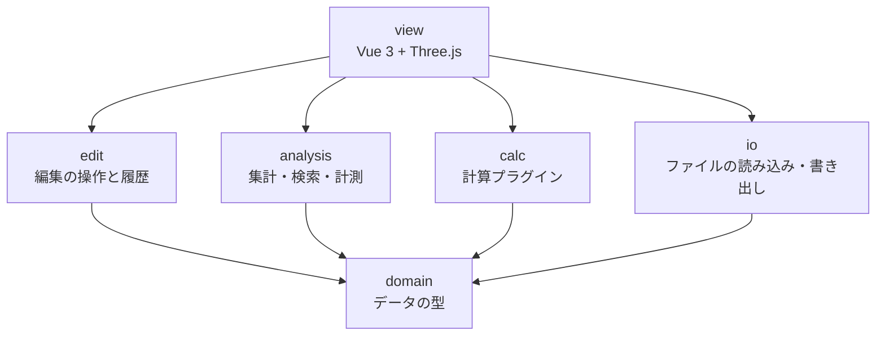

# MineCircuit クラス設計

作成日: 2026-10-19 / 更新: 2026-10-19（編集と書き出しを追加） / 仕様: [spec.md](spec.md)

TypeScriptで書く。コード例は設計を示すためのもので、細部は実装時に決める。

## 基本方針

1. **設計図ファイル1つだけで動く。** Modpack、設定ファイル、計算プラグインは、あればできることが増えるだけで、なくても動く。どの型でも `Modpack | null` のように「ない場合」を扱う。
2. **ファイルにあるものは全部、失わずに持つ。** 解釈できない項目も捨てない。後で使えるようにするためと、将来ファイルに書き戻すときに壊さないため。
3. **読み込みと解釈を分ける。** `Blueprint` / `BlockVolume` は「ファイルに何が入っているか」だけを表す。Modごとの意味づけ（回転のつながりなど）は計算プラグインの中で作る。
4. **値には出どころを付ける。** 計算に使った値が、設計図・Modpack・内蔵の初期値・仮定・仮の入出力のどれから来たかを記録し、結果に表示する。
5. **分からないものは「分からない」と扱う。** 推測で埋めた値は仮定として記録する。
6. **設計図の変更は、編集の操作を通してだけ行う。** 画面や計算プラグインが `BlockVolume` を直接書き換えない。こうすると、すべての変更が元に戻せる。

## 層と依存の向き

依存は上から下への一方向だけ。下の層は上の層を知らない。



## domain：データの型

### ResourceLocation / BlockState

```ts
// "create:shaft" を namespace と path に分けて持つ
class ResourceLocation {
  constructor(readonly namespace: string, readonly path: string) {}
  static parse(s: string): ResourceLocation
  toString(): string
}

class BlockState {
  constructor(
    readonly id: ResourceLocation,
    readonly properties: Readonly<Record<string, string>>, // axis=y, facing=north など
  ) {}
}
```

### Blueprint

設計図ファイル1つ分。ファイルの情報と中身を持つ。

```ts
class Blueprint {
  constructor(
    readonly name: string,                       // ファイル名
    readonly format: 'nbt' | 'schem' | 'litematic',
    readonly dataVersion: number,                // Minecraftのバージョン判定に使う。2975 = 1.18.2
    readonly regions: BlockVolume[],             // .nbt と .schem は1つ、.litematic は複数ありうる
    readonly meta: BlueprintMeta,                // 作者・説明など。ない形式は空
  ) {}

  get size(): Vec3                               // 全リージョンを合わせた大きさ
  get namespaces(): Set<string>                  // 足りないModの検出に使う
  get(pos: Vec3): BlockState | null              // 設計図全体の座標で引く
  blockEntityAt(pos: Vec3): RawNbt | null
  neighbor(pos: Vec3, dir: Direction): BlockState | null  // 範囲外は null
  forEachInLayer(y: number, fn: (pos: Vec3, state: BlockState) => void): void
}

interface BlueprintMeta {
  author?: string
  description?: string
  createdAt?: Date
}
```

- 座標は設計図全体のもので、y が上下（段）。Minecraftと同じ。
- リージョンは最初から配列にする。今は `.nbt` だけで常に1つだが、単数で作ると `.litematic` 対応時に利用箇所を全部直すことになる。

### BlockVolume

1つのリージョンのブロック配置。読み込んだものを全部持つ。

```ts
class BlockVolume {
  readonly name: string                          // リージョン名。.nbt なら "main"
  readonly offset: Vec3                          // 設計図全体の中での位置
  readonly size: Vec3
  readonly palette: BlockState[]
  private readonly cells: Int32Array             // 位置ごとのパレット番号。空気は -1
  private readonly blockEntities: Map<number, RawNbt>  // セル番号 → ブロックエンティティの生データ
  readonly entities: RawEntity[]                 // 額縁、防具立てなど。生データのまま
  readonly extra: RawNbt                         // 解釈していない一番上の階層の項目

  get(x: number, y: number, z: number): BlockState | null
  blockEntityAt(x: number, y: number, z: number): RawNbt | null

  // 編集用。呼ぶのは edit 層の操作だけ
  setCell(x: number, y: number, z: number, cell: CellValue): void
  cellAt(x: number, y: number, z: number): CellValue
  stateIndex(state: BlockState): number   // パレットになければ足す
}

// 1マス分の中身。空きは state = null
interface CellValue {
  state: BlockState | null
  blockEntity: RawNbt | null
}
```

- `cells` を型付き配列にするのは、数万ブロックの設計図でもメモリと速度を抑えるため。
- 編集でパレットに使われない状態が残っても、そのままにする。書き出し時に使っている状態だけでパレットを作り直す。
- ブロックエンティティとエンティティは生データ（`RawNbt`）のまま持つ。中身の解釈は、必要になったModごとにプラグインで行う。
- `extra` には `Railways_DataVersion` のような、Modが足した知らない項目をそのまま入れる。

## io：読み込み

### FileSource

ファイルの読み方をここに閉じ込める。Tauriでデスクトップ版にするときは、ここだけ差し替える。

```ts
interface FileSource {
  list(dir: string): Promise<string[]>
  read(path: string): Promise<ArrayBuffer>
}

// 保存先。ブラウザでは保存先を選ぶ画面、Tauri版ではファイルに直接書く
interface FileSink {
  save(suggestedName: string, data: Uint8Array): Promise<'saved' | 'cancelled'>
}

class BrowserFileSource implements FileSource { /* File System Access API */ }
class BrowserFileSink implements FileSink { /* showSaveFilePicker */ }
```

### BlueprintReader

設計図の形式ごとに1クラス。最初は `.nbt` だけ。

```ts
interface BlueprintReader {
  canRead(fileName: string): boolean
  read(name: string, data: ArrayBuffer): Blueprint
}

class NbtBlueprintReader implements BlueprintReader {}
// 後で: SchemBlueprintReader, LitematicBlueprintReader
```

### BlueprintWriter

読み込みの逆。形式ごとに1クラス。最初は `.nbt` だけ。

```ts
interface BlueprintWriter {
  readonly format: 'nbt' | 'schem' | 'litematic'
  write(bp: Blueprint): Promise<Uint8Array>   // gzip 済み
}

class NbtBlueprintWriter implements BlueprintWriter {}
```

書き出しの規則:

- 一番上の階層は、読み込んだときの生データ（`extra`）を元にする。`size`・`palette`・`blocks` だけを作り直し、`entities`・`DataVersion`・Modが足した項目はそのまま残す
- パレットは、使っている状態だけで作り直す
- 既存ブロックの生データ（nbt）はそのまま書く。新しく置いたブロックには書かない
- 書き出した直後に読み直し、ブロックの配置と状態が元と一致するか確かめる。一致しなければ保存しない
- 新規作成の設計図は `DataVersion` を持たないので、対象のModpackのバージョンから決める。Modpackがなければ利用者に選んでもらう

### Modpack / ModpackLoader

```ts
class ModpackLoader {
  constructor(private source: FileSource) {}
  load(): Promise<Modpack>   // mods/*.jar を開き、Mod情報と表示名を集める
}

class Modpack {
  readonly mods: ModInfo[]                                  // modId, 名前, バージョン
  hasNamespace(ns: string): boolean                         // jar の assets/ 以下のフォルダ名で判定
  displayName(id: ResourceLocation, lang: 'ja_jp' | 'en_us'): string | null
  config(path: string): Promise<string | null>              // 設定ファイルの中身。なければ null
}
```

- namespace と modId は一致しないModがあるため、`hasNamespace` は jar の `assets/<namespace>/` で判定する。
- jar から読むのは翻訳ファイル・モデル・ブロック状態の定義・テクスチャだけ。Javaのコードは実行しない。
- 読み込んだ表示名の一覧はブラウザ内に保存し、2回目以降を速くする。

## analysis：集計と検索

```ts
class BlueprintStats {
  constructor(private bp: Blueprint) {}
  countAll(): Map<string, number>
  countLayer(y: number): Map<string, number>
  bounds(): { min: Vec3; max: Vec3 }
}

class MissingModDetector {
  detect(bp: Blueprint, pack: Modpack): string[]   // 足りない namespace の一覧
}

class BlockSearch {
  find(bp: Blueprint, id: ResourceLocation): Vec3[]
}
```

## analysis：計測

```ts
interface Measurement {
  a: Vec3
  b: Vec3
  delta: Vec3                 // b - a
  euclidean: number           // 直線距離
  manhattan: number           // 軸に沿った距離。シャフトやベルトを引く長さの目安
  boundingSize: Vec3          // 2点を囲む範囲
}

function measure(a: Vec3, b: Vec3): Measurement
function floodSameState(bp: Blueprint, start: Vec3): Vec3[]   // 隣り合う同じ種類のブロック
```

`floodSameState` は「つながり」ツールで使う。回転や配管のつながりではないので、画面にもそう書く。本当のつながりは計算プラグインが作る（`KineticGraph` など）。

## edit：編集の操作と履歴

### 操作

すべての変更を操作（コマンド）として表す。操作は「どのマスが、何から何に変わったか」の一覧を持つので、元に戻すのもやり直すのも同じ形で扱える。

```ts
interface CellChange {
  pos: Vec3
  before: CellValue
  after: CellValue
}

interface EditCommand {
  readonly label: string              // 「shaft を置く」。元に戻すボタンのツールチップに出す
  readonly changes: CellChange[]
}

// 操作を作る関数。Blueprint は変えず、変更の一覧だけを返す
function placeBlock(bp: Blueprint, pos: Vec3, state: BlockState, replace: boolean): EditCommand | null
function eraseBlock(bp: Blueprint, pos: Vec3): EditCommand | null
function rotateBlock(bp: Blueprint, pos: Vec3, vertical: boolean): EditCommand | null
// 後で: fillRegion, copyRegion, rotateRegion, resizeBlueprint
```

- 新しく置いたブロックは `blockEntity: null`。計算では値の出どころの仕組みで初期値を使う
- 回転では生データ（nbt）をそのまま引き継ぐ
- 範囲の外への配置は、範囲の拡張（`resizeBlueprint`）を作るまでは受け付けない

### 履歴

```ts
class EditHistory {
  constructor(private bp: Blueprint) {}
  apply(cmd: EditCommand): void    // after を書き込み、undo に積む。redo は空にする
  undo(): EditCommand | null       // before を書き戻す
  redo(): EditCommand | null
  get canUndo(): boolean
  get canRedo(): boolean
  get count(): number              // 画面の「編集 n 回」
  readonly onChange: Signal<void>  // 画面・集計・計算の再実行の合図
}
```

変更のたびに、集計（ブロック数）、3D表示、計算を更新する。計算は変更が続く間は待ち、止まってから Web Worker で走らせる。

### 置くブロック（ブラシ）

```ts
class BlockBrush {
  state: BlockState
  rotate(vertical: boolean): void   // R / Shift+R
  static fromBlock(state: BlockState): BlockBrush   // スポイト
}
```

回転の規則:

| プロパティ | R（水平） | Shift+R（縦） |
| --- | --- | --- |
| `axis` | x ↔ z | y にする（y なら x に戻す） |
| `facing` | north → east → south → west | up → down → north |
| `horizontal_facing` | north → east → south → west | 変えない |

Modpackがないと、そのブロックが取りうる値が分からない。Modpackがあれば、jar のブロック状態の定義（`assets/<namespace>/blockstates/<path>.json`）から取りうる値を読み、その範囲で回す。

## 値の出どころ

計算に使う値はどのModでも3種類に分かれる。

| 種類 | 例 | 出どころ（優先順） |
| --- | --- | --- |
| 個体の設定値 | クリエイティブモーターの回転数、速度コントローラーの設定 | ① 設計図の nbt → ② Modpackの初期値設定 → ③ 内蔵の初期値 |
| Modの定数 | 各ブロックの応力の消費量・供給量、回転数の上限 | ① Modpackの設定ファイル → ② 内蔵の初期値 |
| 構造から分かるもの | ベルトのつながり、シャフトの向き | ① ブロック状態 → ② nbt で補う |

```ts
type Provenance =
  | 'blueprint'   // 設計図の nbt やブロック状態から読んだ
  | 'modpack'     // Modpackの設定ファイルから読んだ
  | 'builtin'     // アプリ内蔵の初期値
  | 'virtual'     // 利用者が置いた仮の入出力
  | 'assumed'     // 情報がなく、アプリが仮定した

interface Resolved<T> {
  value: T
  source: Provenance
  note?: string   // 「範囲外は空気とみなした」など
}
```

優先順に値を探す処理と出どころの記録は共通部分に置く。各プラグインは「自分の内蔵の初期値」と「どこから値を引くか」の規則だけを書く。

## 設計図に入っていない情報

設計図ファイルはブロックとブロックエンティティの写しなので、次の情報は原理的に入らない。

| 種類 | 例 |
| --- | --- |
| ワールド全体に保存されるデータ | AE2のネットワーク、Createの線路網と列車、周波数でつながる送信機 |
| 設計図の範囲の外 | 範囲外の動力源や接続先 |
| 実行中にしかない状態 | 計算途中の値、組み立て中の仕掛け、毎tick再計算されるもの |
| 周りの環境 | バイオーム、明るさ、高度、天候 |

扱い方は2つ。

- **仮定（`assumed`）**：アプリが自動で置く。範囲外は空気とみなす、など。計算結果の仮定一覧に必ず載せる。
- **仮の入出力（`virtual`）**：利用者が意図して置く。下の `VirtualPort`。

## 仮の入出力（VirtualPort）

設計図の端のブロックの面に、利用者が仮の動力源や負荷を付けられる。計算では本物のブロックと同じように扱う。

```ts
interface VirtualPort {
  id: string
  pos: Vec3                       // 接続するブロックの位置
  face: Direction                 // どの面から入るか
  pluginId: string                // 'create-stress' など
  kind: string                    // 'rotation-source' など。種類はプラグインが定義
  params: Record<string, number>  // { rpm: 256, capacity: 4096 }
  label?: string                  // 「外の水車列」などのメモ
}
```

| プラグイン | 仮の入出力の例 |
| --- | --- |
| Createの応力 | 回転の供給（RPM、SU）、回転の消費（SU） |
| 電力系 | 電力の供給（FE/t）、電力の消費 |
| 生産量計算（将来） | アイテムの流入（個/分）、流体の流入（mB/秒） |

## calc：計算プラグイン

```ts
interface CalcPlugin {
  readonly id: string                          // 'create-stress'
  readonly portKinds: PortKindDef[]            // 受け付ける仮の入出力の種類。画面の入力欄に使う
  supports(bp: Blueprint, pack: Modpack | null): boolean
  run(bp: Blueprint, ctx: CalcContext): Promise<CalcResult>
}

interface CalcContext {
  pack: Modpack | null            // なければ内蔵の初期値で計算
  ports: VirtualPort[]            // このプラグイン宛ての仮の入出力
}

interface CalcResult {
  summary: { label: string; value: Resolved<string> }[]   // 「使用 2,048 SU / 供給 4,096 SU」
  issues: { pos: Vec3; message: string }[]                // 3D表示で強調する位置
  assumptions: { pos?: Vec3; message: string }[]          // 何を仮定して計算したか
}

class PluginRegistry {
  register(p: CalcPlugin): void
  available(bp: Blueprint, pack: Modpack | null): CalcPlugin[]
}
```

### 例：Createの応力プラグイン

```ts
class CreateStressPlugin implements CalcPlugin {
  async run(bp: Blueprint, ctx: CalcContext): Promise<CalcResult> {
    const values = new CreateValueResolver(CREATE_DEFAULTS, await CreateConfig.load(ctx.pack))
    const graph = KineticGraph.build(bp, ctx.ports)   // ブロックと向きから回転のつながりを作る
    return graph.evaluate(values)                      // ネットワークごとに供給と消費を比べる
  }
}
```

`KineticGraph` はCreate用に解釈したデータで、プラグインの中だけで使う。回転のつながり、数値、計算の手順は [create-stress.md](create-stress.md) に書く。

## ゲームとの行き来

書き出した `.nbt` は、Modpackの `schematics` フォルダに置けばCreateで読み込めるはず（未確認）。ゲームに持ち込むと、次のものが欠ける可能性がある。

- アプリで置いたブロックの生データ（ゲーム側の初期値になる）
- スキーマティキャノンが復元しない生データ
- Modpackにない Mod のブロック

書き出しの画面で、生データのないブロックの数と、足りないModを書き出し前に知らせる。

## アプリ独自のファイル

仮の入出力やメモは `.nbt` に書き込めないので、設計図とは別のファイルに保存する。

```
distillery.nbt             ← 設計図（そのまま）
distillery.mcircuit.json   ← 仮の入出力、メモ、建築チェックリスト、表示の設定
```

```ts
interface ProjectFile {
  version: 1
  blueprint: string               // 設計図のファイル名
  ports: VirtualPort[]
  notes: { pos: Vec3; text: string }[]
  checklist: { layer: number; done: boolean }[]
}
```

最初の版で作るかは別として、置き場所だけ先に決めておく。

## view：画面

- `ViewState`（Piniaのストア）：今の段、段の表示方法（上を消す・半透明・この段だけ）、段ごとの表示・非表示、3D/2D の切り替え、強調するブロック、今のツール
- `BlueprintMeshBuilder`：パレットの種類ごとに Three.js の InstancedMesh を1つ作る。ブロック数が多くても描画が軽い
- `LayerView2D`：選んだ段を canvas にマス目で描く。1つ下の段を薄く出す
- `Picker`：マウス位置から対象を求める。3D は当たったブロックと面の向き、何もなければ今の段の床。2D はマス目
- ツール：ツールごとにクラスを分け、同じ形でクリックと移動を受け取る

```ts
interface Tool {
  readonly id: 'select' | 'measure' | 'connect' | 'probe' | 'place' | 'erase' | 'pick'
  onHover(target: PickTarget | null): void
  onClick(target: PickTarget, mods: { shift: boolean }): void
}

interface PickTarget {
  pos: Vec3                 // 当たったブロック、または空きマス
  face?: Direction          // 3D で当たった面
  empty: boolean
}
```

プロトタイプでは、段を切り替えるたびにメッシュを作り直している。約9千ブロックで問題なく動いた。本実装では段の切り替えを描画側のクリッピングにする予定は変えない。

## 実物の .nbt で確認したこと

Create Astral（1.18.2）の設計図 `_.nbt`（8×1×4、23ブロック）と `[AstralExamples] Distillery.nbt` で確認した。

- 一番上の階層: `DataVersion`（2975）、`size`、`palette`、`blocks`、`entities`、`Railways_DataVersion`
- `palette` の各要素: `Name` と `Properties`（例: `create:cogwheel`、`axis: y`）
- `blocks` の各要素: `pos`、`state`（パレット番号）、`nbt`（ブロックエンティティの生データ。23個中16個が持つ）
- 歯車の `nbt`: `Speed`、`Source`（ワールド座標）、`Network`（`Size`、`Capacity`、`Stress` など）
- ベルトの `nbt`: `Controller`、`Length`、`Index`、載っているアイテム
- `Network` は保存時のワールドの状態で、設計図の外のブロックを含む（`Size: 26` に対して設計図内は23個）。計算結果には使わず、参考値として表示する程度にとどめる
- Distillery には `techreborn:`、`dbe:`、`custommachinery:` のブロックが含まれていた

## 未確認事項

- [x] ベルトのブロック状態だけで、つながりを組み立てられるか → 組み立てられる（[create-stress.md](create-stress.md)）
- [x] クリエイティブモーターなど、個体の設定値の初期値 → 16 RPM（[create-stress.md](create-stress.md)）
- [x] Createの応力の数値が、ワールドごとの `serverconfig/create-server.toml` に入っているか → 入っている（[create-stress.md](create-stress.md)）
- [x] Createのバージョンで、nbt の項目名が変わっていないか → 名前は同じ。位置の書き方だけ違う（[create-stress.md](create-stress.md)）
- [ ] 書き出した .nbt をCreateで読み込めるか。生データのないブロックがどう置かれるか
- [ ] ブロック状態の定義（blockstates の JSON）から、取りうる値の一覧を確実に作れるか。multipart 形式のブロックの扱い
- [ ] 新規作成の設計図の `DataVersion` をどう決めるか
