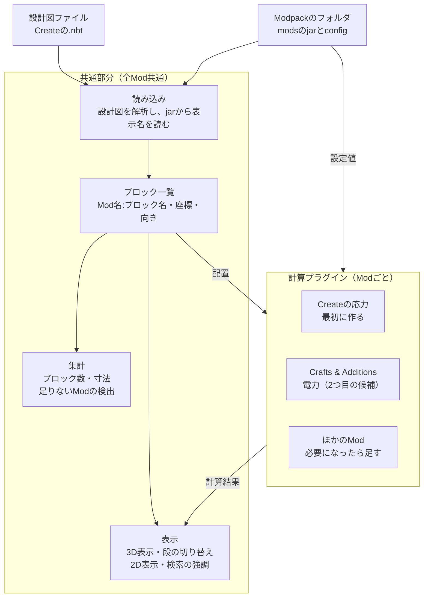

# MineCircuit 仕様たたき台

作成日: 2026-10-19 / 更新: 2026-10-22（デスクトップ版を追加）

工業Modの機械や工場を、ゲームの外で確認・編集・計算できるアプリを作る。ブラウザで動くWebアプリと、それをTauriで包んだデスクトップアプリの2つを、同じコードから作る。最初はCreateの設計図に対応し、Modpackごとの読み込みと計算プラグインで対象を広げる。編集した設計図は `.nbt` で書き出し、ゲームに持ち込める。

UIのプロトタイプ（2026-10-19時点）で、表示・段の切り替え・計測・編集・書き出しの操作感を確認済み。

## 目的と背景

クリエイティブモードで設計するときの不満点は2つある。

- キャラクターを動かして作業するので、操作が面倒
- ブロック数が分からない

既存ツールとの関係は次のとおり。

| ツール | できること | 足りない点 |
| --- | --- | --- |
| Axiom | 3Dソフトのような操作で地形や建築を編集 | Fabric専用。ATM10（NeoForge 1.21.1）とCreate Astral（Fabric 1.18.2）では使えない |
| Litematica | 設計図をゲーム内に重ねて表示。1段ずつの表示 | ゲーム内でしか使えない。2D表示がない。計算しない |
| WorldEdit | 範囲の一括編集、`//distr` でブロック数の集計 | 見た目の確認や段ごとの表示はできない |
| Createのスキーマティック | 機械の保存と貼り付け、必要素材の一覧 | 中身の確認や計算はできない |

このアプリの強みは、ゲームの外で動くこと、Modpackを読み込むこと、計算することの3点。機能の優先度はこの3点を使うかどうかで決める。

## 想定ユーザー

一番確実なユーザーは1の設計者で、人数が多いのは2の設計図を使う人。

| # | ユーザー | やりたいこと | 必要な機能 |
| --- | --- | --- | --- |
| 1 | 工業Modで工場を設計する人 | 機械を組んで改良し、サバイバルで使う | 段ごとの確認、ブロック数、応力の計算 |
| 2 | 他人の設計図を使う人 | 配布された設計図を建てる前に調べる | 中身の確認、材料の一覧、自分のModpackで使えるかの判定 |
| 3 | 設計図を見ながら手で建てる人 | スキーマティキャノンを使わず1段ずつ建てる | 段ごとの表示、建て終えた段の記録 |
| 4 | 解説を作る人 | YouTubeやブログで工場の作り方を解説する | 断面図と1段ごとの画像の書き出し |
| 5 | Modpackの制作者 | 応力などの数値を調整してバランスを確かめる | 設定ファイルの数値での計算 |

2と3の層は、ゲーム内で使えるLitematicaと競合する。この層には、ゲーム外で動くこととModpackの読み込みで差をつける。

## 全体構成

共通部分はプラグインがなくても動き、どのModの設計図でも配置と数を確認できる。計算プラグインは「ブロック一覧と設定値を受け取り、結果と問題のある位置を返す」という同じ決まりで作り、Modごとに1つずつ足す。

## 機能一覧と優先度

優先度Aは最初の版に入れる。Bは応力計算の後、Cは使いながら判断する。「ユーザー」の番号は上の表の番号。

| 機能 | ユーザー | 難しさ | 優先度 |
| --- | --- | --- | --- |
| スキーマティック（.nbt）の読み込み | 全員 | 低 | A |
| 3D表示（回転・移動・拡大） | 全員 | 中 | A |
| 段の選択と、上を消す・半透明にする切り替え | 1, 2, 3 | 低 | A |
| 選んだ段の2D表示 | 1, 3 | 低 | A |
| ブロック数の表示（全体と今の段） | 1, 2, 3 | 低 | A |
| 足りないModの検出 | 2 | 低 | A |
| ブロックの種類で検索して強調表示 | 1, 3 | 低 | A |
| 寸法の表示（幅・奥行き・高さ） | 1, 2, 3 | 低 | A |
| Modpackのjarから表示名を読み込む | 全員 | 中 | A |
| 計測（2つのブロックの距離・範囲） | 1, 3 | 低 | A |
| 段ごとの表示・非表示の切り替え | 1, 3 | 低 | A |
| ブロックを置く・消す・置き換える（2D・3D） | 1 | 中 | A |
| ブロックの回転（向き・軸） | 1 | 低 | A |
| 元に戻す・やり直す | 1 | 中 | A |
| 新規の設計図を作る | 1 | 低 | A |
| .nbt の書き出し | 1 | 中 | A |
| Createの応力計算 | 1, 5 | 高 | B |
| 回転でつながったブロックの強調（ネットのハイライト） | 1 | 中 | B |
| プローブ（クリックしたブロックの回転数・応力） | 1 | 中 | B |
| 範囲選択での一括操作（消す・塗りつぶし・置き換え・移動・コピーと貼り付け・回転・反転。#129） | 1 | 中 | B |
| 設計図の範囲の拡張・縮小 | 1 | 中 | B |
| Modpackのブロック状態の定義を使った向きの選択 | 1 | 中 | B |
| 応力が足りない場所の表示 | 1 | 中 | B |
| 組み間違いの検査（計算から外れたブロック・止まっているブロックを問題に出す。回路エディタの ERC にあたる。#148） | 1, 2 | 中 | B |
| 生産量の計算と律速（物の入口から1分あたりの個数を出し、一番忙しい機械に印を付ける。#168） | 1 | 高 | B |
| 段ごとの建築チェックリスト | 3 | 低 | B |
| 画像の書き出し（断面図、段ごとの画像） | 4 | 中 | B |
| テクスチャの表示 | 全員 | 中 | B |
| 2つの版の比較 | 1 | 中 | C |
| ブロックへのメモ書き | 1, 4 | 中 | C |
| 形式の変換（.nbt ↔ .schem ↔ .litematic） | 2 | 中 | C |
| 2つ目の計算プラグイン（Crafts & Additionsの電力など） | 1 | 高 | C |
| 原材料までの展開 | 2, 3 | 高 | C |

原材料までの展開は需要が高いが、KubeJSなどでレシピが変わっていると正しく出せない。間違った数字を出すよりは、後回しにする。

## 最初の版の範囲

最初の版は「Createの設計図を開いて、中身を見て、数えて、編集して、書き出す」までにする。計算は入れない。

入れるもの（優先度A）

- スキーマティック（.nbt）の読み込み
- 3D表示。ブロックは色付きの立方体で表示する
- 段の選択と、上を消す・半透明にする切り替え。段ごとの表示・非表示
- 選んだ段の2D表示
- ブロック数の表示（全体と今の段）
- ブロックの検索と強調表示
- 寸法の表示、計測
- Modpackのフォルダを指定して、表示名の読み込みと足りないModの検出
- ブロックを置く・消す・置き換える・回転する。2Dと3Dの両方で
- 元に戻す・やり直す
- 新規の設計図を作る
- .nbt の書き出し

入れないもの

- 計算（応力、電力、生産量）
- 範囲選択での一括操作
- 設計図の範囲の拡張・縮小
- テクスチャと本物の形の表示
- .schem と .litematic の読み込み・書き出し
- 機械やチェストの中身の表示と編集

この範囲で、最初に挙げた2つの不満点（操作のしにくさ、ブロック数）は解決する。特に「キャラクターを動かして作業するので操作が面倒」には、2Dのマス目でブロックを置いていく編集が一番まっすぐ応える。

## ゲームとの行き来

書き出す `.nbt` はCreateのスキーマティックと同じ構造物NBTなので、Modpackの `schematics` フォルダに置けばゲームで読み込めるはず。ただし、次の制限が出る可能性がある（未確認）。

- アプリで新しく置いたブロックには生データ（nbt）がない。モーターの回転数などはゲーム側の初期値になる
- スキーマティキャノンは、ブロックによって生データを復元しない場合がある
- Modpackにない Mod のブロックは置かれない

書き出しでは、読み込んだファイルの知らない項目（`Railways_DataVersion` など）、エンティティ、既存ブロックの生データをそのまま残す。プロトタイプで、書き出したファイルを別のNBTライブラリで読み直し、これらが残ることを確認した。

## 画面構成

プロトタイプで確認した配置。画面の画像とツールの説明は [ui.md](ui.md) にある。

| 場所 | 内容 |
| --- | --- |
| 上のバー1段目 | 設計図（新規・開く・書き出し（.nbt））、Modpack、設計図の情報（寸法、ブロック数、種類、nbt付きの数、エンティティ数、バージョン、書き出してからの変更の回数） |
| 上のバー2段目 | 3D/2D、視点（斜め・上・正面・横、全体を表示）、段の移動と表示方法、補助表示（グリッド・座標軸・略称・回転）、選択と強調の解除、編集（元に戻す・やり直す）、パネルの表示、全画面 |
| 左パネル | 置くブロック、ブロック一覧（全体／この段、検索、強調）、使っているMod |
| 表示部分 | 3D/2D表示。左上に縦のツールバー（選択・計測・つながり・プローブ・仮の入出力・置く・消す・スポイト）。左下に結果の表示（計測、お知らせ、書き出し） |
| 段の一覧 | 段ごとのブロック数と、段ごとの表示・非表示。「隠した段を戻す」 |
| 右パネル | 選択中のブロック（ID、位置、ブロック状態、生データのツリー）、計算結果 |
| 下の状態表示 | マウス位置、選択中のブロック |

キー操作: V 選択 / M 計測 / C つながり / P プローブ / O 仮の入出力 / B 置く / E 消す / I スポイト / R 回転（Shift+R で縦）/ Ctrl+Z・Ctrl+Y / Ctrl+S 書き出し / G グリッド / PageUp・PageDown で段の移動 / Esc で選択解除

## 開発の順番

各段階の後に自分で使い、足りない点を次の段階の仕様にする。

1. 試作ワールドで機械を何台か設計し、困った点をメモする。Create AstralにLitematicaを入れて、1段ずつの表示も試す
2. 共通部分：.nbtの読み込み、3D表示、段の切り替え、ブロック数
3. 2D表示、検索、寸法、計測
4. 編集：置く・消す・回転、元に戻す、新規作成、.nbt の書き出し。書き出したファイルをゲームで読み込めるか確かめる
5. Modpackのjarと設定の読み込み、足りないModの検出、ブロック状態の定義を使った向きの選択
6. Createの応力計算。回転のつながりを追う部分が一番大変。ネットのハイライトとプローブもここで使えるようになる
7. 2つ目の計算プラグイン。候補はCreate Crafts & Additionsの電力
8. デスクトップ版：Tauriで包み、Windows用のインストーラーを作る。ファイルの読み書きをPCのファイルに直接つなぐ

2〜5で最初の版になる。

## 技術スタック

同じコードから2つの形で配る。

| 形 | 動く場所 | 配り方 |
| --- | --- | --- |
| ブラウザ版 | ChromeとEdge（FirefoxとSafariは一部の機能が制限される） | 静的サイト。サーバーは使わない |
| デスクトップ版 | Windows（WebView2）。macOSとLinuxは後で | Tauri 2で包んだインストーラー（.msi / .exe）。GitHubのリリースに置く |

- 画面: Vue 3
- 3D表示: Three.js
- NBTの読み込み: 自前で実装（`src/io/nbt/`）
- jarの読み込み: fflate。jarはzipなので、Javaは使わない
- フォルダの読み込み: ブラウザ版はFile System Access API（Chrome / Edge）。デスクトップ版はTauriのファイル読み書き（`@tauri-apps/plugin-fs`）とファイル選択（`@tauri-apps/plugin-dialog`）

方針

- Modpackのファイルは利用者のPCの中だけで処理し、外部に送らない。通信量と権利の問題を避けるため。画面に「ファイルは外部に送信しない」と書く。デスクトップ版も通信をしない（自動更新も入れない）
- jarから読むのは翻訳ファイル、モデル、ブロック状態の定義、テクスチャだけ。どれもデータファイルで、Javaのコードは実行しない
- ファイルを読む部分を1か所（`FileSource` / `FileSink`）にまとめる。デスクトップ版はここだけを差し替え、ほかのコードは同じものを使う
- デスクトップ版のRust側には、Tauriの起動と公式プラグインの設定だけを書く。読み込み・編集・計算はすべてTypeScriptのまま。こうするとブラウザ版と動きがずれず、テストもVitestだけで済む
- 読み込んだ表示名の一覧はアプリ内（IndexedDB）に保存し、2回目以降の読み込みを速くする

ブラウザ版とデスクトップ版の差

- ChromeとEdgeは、フォルダを選んで読み込み、次回も同じフォルダを読める。ただし、ブラウザの判断で読む許可が切れると、許可を出し直す
- FirefoxとSafariは、フォルダの読み込みはできるが、次回は選び直しになる
- デスクトップ版は、一度登録したフォルダを、次回も許可なしで読む。保存先も自由に選べる

デスクトップ版で使わないもの

- 自動更新、ネットワーク通信、シェルの実行。どれも外部とのやり取りやPCの操作になるので、入れるときは先に確認を取る
- 署名：最初の版はコード署名をしない。Windowsの警告（SmartScreen）が出ることをREADMEに書く

## 技術メモ

- スキーマティックにはブロックが「Mod名:ブロック名」で記録される。判別と数え上げはModの中身を知らなくてもできる
- 表示名は各Modのjarの `assets/<Mod名>/lang/` にある `en_us.json` と `ja_jp.json` から読む
- 3D表示にはmisode氏の「deepslate」ライブラリが使える可能性がある
- 計算の数値はアプリに直接書かず、Modpackの設定ファイルから読む。なければ初期値を使う
- Modのテクスチャやモデルはアプリに同梱しない。ユーザーのPCのjarから読む
- 対象の環境: ATM10（NeoForge 1.21.1、483 Mod）、Create Astral（Fabric 1.18.2、199 Mod）

## 未確認事項

- [x] Createの応力の数値が、ワールドごとの `serverconfig/create-server.toml` に入っているか → 入っている。ファイルがなければ初期値はコードの中にしかない（[create-stress.md](create-stress.md)）
- [ ] Createのjarに、歯車やシャフトの形を記述したJSONモデルがあるか
- [ ] 1.18.2と1.21.1で、.nbtのブロック状態の書き方にどんな差があるか
- [ ] deepslateがModのモデルとテクスチャを読めるか
- [ ] LitematicaのFabric 1.18.2版で、Createの機械が正しく表示されるか
- [ ] ATM10のjar 483個を、ブラウザで現実的な時間で読み込めるか
- [ ] 書き出した .nbt を `schematics` フォルダに置いて、Createで読み込めるか
- [ ] スキーマティキャノンや設計図の配置で、生データがどこまで復元されるか
- [ ] 生データのないブロック（アプリで置いたもの）が、ゲームでどう扱われるか
- [ ] デスクトップ版で、ATM10のjar 483個の読み込みがブラウザ版より速くなるか（jarの必要な部分だけを読めるか）
- [ ] デスクトップ版（WebView2）で、Web Worker・IndexedDB・CompressionStreamがブラウザ版と同じに動くか
- [ ] 署名していないインストーラーで、Windowsの警告がどう出るか
