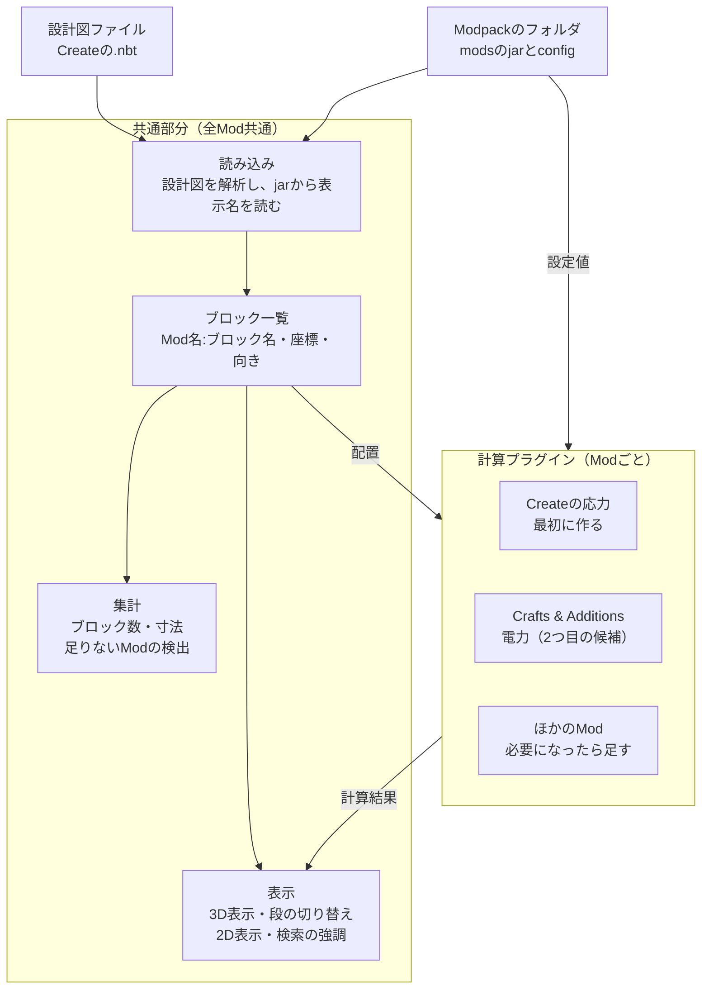

# MineCircuit 仕様たたき台

作成日: 2026-10-19

工業Modの機械や工場を、ゲームの外で確認・計算できるWebアプリを作る。最初はCreateの設計図に対応し、Modpackごとの読み込みと計算プラグインで対象を広げる。

## 目的と背景

クリエイティブモードで設計するときの不満点は2つある。

- キャラクターを動かして作業するので、操作が面倒
- ブロック数が分からない

既存ツールとの関係は次のとおり。

| ツール | できること | 足りない点 |
| --- | --- | --- |
| Axiom | 3Dソフトのような操作で地形や建築を編集 | Fabric専用。ATM10（NeoForge 1.21.1）とCreate Astral（Fabric 1.18.2）では使えない |
| Litematica | 設計図をゲーム内に重ねて表示。1段ずつの表示 | ゲーム内でしか使えない。2D表示がない。計算しない |
| WorldEdit | 範囲の一括編集、`//distr` でブロック数の集計 | 見た目の確認や段ごとの表示はできない |
| Createのスキーマティック | 機械の保存と貼り付け、必要素材の一覧 | 中身の確認や計算はできない |

このアプリの強みは、ゲームの外で動くこと、Modpackを読み込むこと、計算することの3点。機能の優先度はこの3点を使うかどうかで決める。

## 想定ユーザー

一番確実なユーザーは1の設計者で、人数が多いのは2の設計図を使う人。

| # | ユーザー | やりたいこと | 必要な機能 |
| --- | --- | --- | --- |
| 1 | 工業Modで工場を設計する人 | 機械を組んで改良し、サバイバルで使う | 段ごとの確認、ブロック数、応力の計算 |
| 2 | 他人の設計図を使う人 | 配布された設計図を建てる前に調べる | 中身の確認、材料の一覧、自分のModpackで使えるかの判定 |
| 3 | 設計図を見ながら手で建てる人 | スキーマティキャノンを使わず1段ずつ建てる | 段ごとの表示、建て終えた段の記録 |
| 4 | 解説を作る人 | YouTubeやブログで工場の作り方を解説する | 断面図と1段ごとの画像の書き出し |
| 5 | Modpackの制作者 | 応力などの数値を調整してバランスを確かめる | 設定ファイルの数値での計算 |

2と3の層は、ゲーム内で使えるLitematicaと競合する。この層には、ゲーム外で動くこととModpackの読み込みで差をつける。

## 全体構成

共通部分はプラグインがなくても動き、どのModの設計図でも配置と数を確認できる。計算プラグインは「ブロック一覧と設定値を受け取り、結果と問題のある位置を返す」という同じ決まりで作り、Modごとに1つずつ足す。

## 機能一覧と優先度

優先度Aは最初の版に入れる。Bは応力計算の後、Cは使いながら判断する。「ユーザー」の番号は上の表の番号。

| 機能 | ユーザー | 難しさ | 優先度 |
| --- | --- | --- | --- |
| スキーマティック（.nbt）の読み込み | 全員 | 低 | A |
| 3D表示（回転・移動・拡大） | 全員 | 中 | A |
| 段の選択と、上を消す・半透明にする切り替え | 1, 2, 3 | 低 | A |
| 選んだ段の2D表示 | 1, 3 | 低 | A |
| ブロック数の表示（全体と今の段） | 1, 2, 3 | 低 | A |
| 足りないModの検出 | 2 | 低 | A |
| ブロックの種類で検索して強調表示 | 1, 3 | 低 | A |
| 寸法の表示（幅・奥行き・高さ） | 1, 2, 3 | 低 | A |
| Modpackのjarから表示名を読み込む | 全員 | 中 | A |
| Createの応力計算 | 1, 5 | 高 | B |
| 応力が足りない場所の表示 | 1 | 中 | B |
| 段ごとの建築チェックリスト | 3 | 低 | B |
| 画像の書き出し（断面図、段ごとの画像） | 4 | 中 | B |
| テクスチャの表示 | 全員 | 中 | B |
| 2つの版の比較 | 1 | 中 | C |
| ブロックへのメモ書き | 1, 4 | 中 | C |
| 形式の変換（.nbt ↔ .schem ↔ .litematic） | 2 | 中 | C |
| 2つ目の計算プラグイン（Crafts & Additionsの電力など） | 1 | 高 | C |
| 生産量の計算（1分あたりの個数） | 1 | 高 | C |
| 原材料までの展開 | 2, 3 | 高 | C |

原材料までの展開は需要が高いが、KubeJSなどでレシピが変わっていると正しく出せない。間違った数字を出すよりは、後回しにする。

## 最初の版の範囲

最初の版は「Createの設計図を開いて、中身を見て、数える」だけにする。編集と計算は入れない。

入れるもの（優先度A）

- スキーマティック（.nbt）の読み込み
- 3D表示。ブロックは色付きの立方体で表示する
- 段の選択と、上を消す・半透明にする切り替え
- 選んだ段の2D表示
- ブロック数の表示（全体と今の段）
- ブロックの検索と強調表示
- 寸法の表示
- Modpackのフォルダを指定して、表示名の読み込みと足りないModの検出

入れないもの

- 設計図の編集と書き戻し
- 計算（応力、電力、生産量）
- テクスチャと本物の形の表示
- .schem と .litematic の読み込み
- 機械やチェストの中身の表示

この範囲で、最初に挙げた2つの不満点（操作のしにくさ、ブロック数）は解決する。

## 開発の順番

各段階の後に自分で使い、足りない点を次の段階の仕様にする。

1. 試作ワールドで機械を何台か設計し、困った点をメモする。Create AstralにLitematicaを入れて、1段ずつの表示も試す
2. 共通部分：.nbtの読み込み、3D表示、段の切り替え、ブロック数
3. 2D表示、検索、寸法
4. Modpackのjarと設定の読み込み、足りないModの検出
5. Createの応力計算。回転のつながりを追う部分が一番大変
6. 2つ目の計算プラグイン。候補はCreate Crafts & Additionsの電力

2〜4で最初の版になる。

## 技術スタック

ブラウザで動くWebアプリにする。サーバーは使わず、静的サイトとして配布する。

- 画面: Vue 3
- 3D表示: Three.js
- NBTの読み込み: `prismarine-nbt` などのライブラリ
- jarの読み込み: JSZip など。jarはzipなので、Javaは使わない
- フォルダの読み込み: File System Access API（Chrome / Edge）

方針

- Modpackのファイルはブラウザ内だけで処理し、サーバーに送らない。通信量と権利の問題を避けるため。画面に「ファイルは外部に送信しない」と書く
- jarから読むのは翻訳ファイル、モデル、ブロック状態の定義、テクスチャだけ。どれもデータファイルで、Javaのコードは実行しない
- ファイルを読む部分を1か所にまとめる。後でTauriに包んでデスクトップアプリにできるようにするため
- 読み込んだ表示名の一覧はブラウザ内に保存し、2回目以降の読み込みを速くする

ブラウザの差

- ChromeとEdgeは、フォルダを選んで読み込み、次回も同じフォルダを読める
- FirefoxとSafariは、フォルダの読み込みはできるが、次回は選び直しになる

## 技術メモ

- スキーマティックにはブロックが「Mod名:ブロック名」で記録される。判別と数え上げはModの中身を知らなくてもできる
- 表示名は各Modのjarの `assets/<Mod名>/lang/` にある `en_us.json` と `ja_jp.json` から読む
- 3D表示にはmisode氏の「deepslate」ライブラリが使える可能性がある
- 計算の数値はアプリに直接書かず、Modpackの設定ファイルから読む。なければ初期値を使う
- Modのテクスチャやモデルはアプリに同梱しない。ユーザーのPCのjarから読む
- 対象の環境: ATM10（NeoForge 1.21.1、483 Mod）、Create Astral（Fabric 1.18.2、199 Mod）

## 未確認事項

- [ ] Createの応力の数値が、ワールドごとの `serverconfig/create-server.toml` に入っているか。入っていない場合、初期値はJavaのコードの中にしかない可能性がある
- [ ] Createのjarに、歯車やシャフトの形を記述したJSONモデルがあるか
- [ ] 1.18.2と1.21.1で、.nbtのブロック状態の書き方にどんな差があるか
- [ ] deepslateがModのモデルとテクスチャを読めるか
- [ ] LitematicaのFabric 1.18.2版で、Createの機械が正しく表示されるか
- [ ] ATM10のjar 483個を、ブラウザで現実的な時間で読み込めるか
