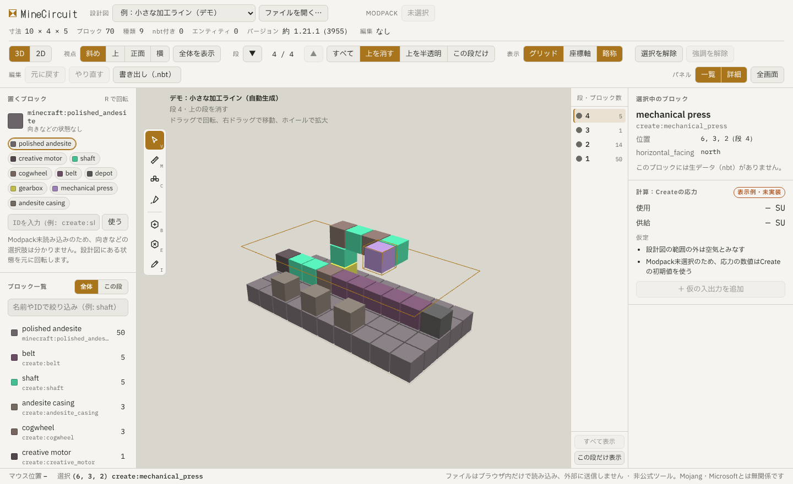
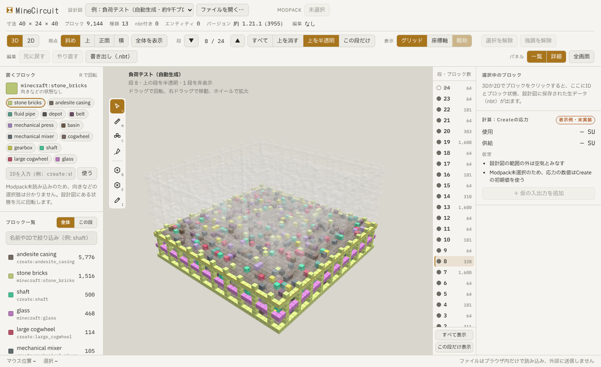
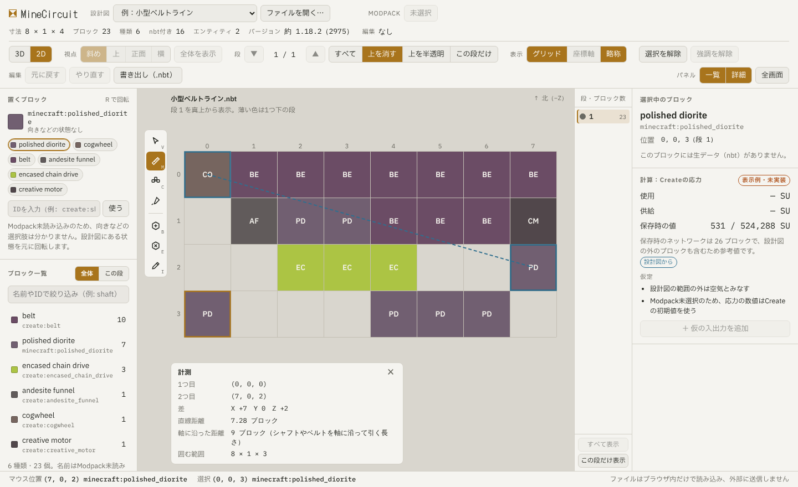
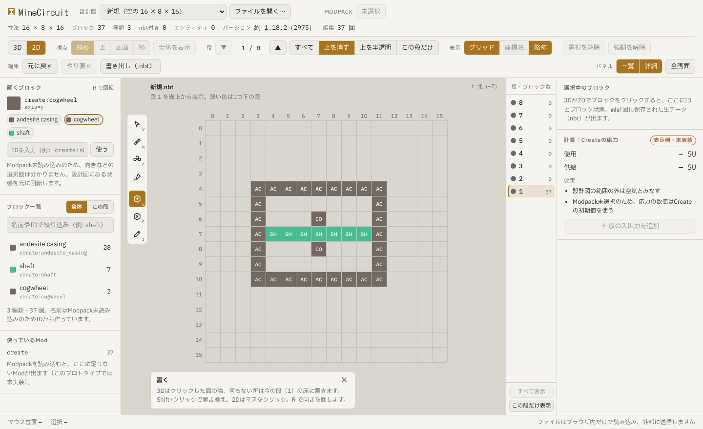
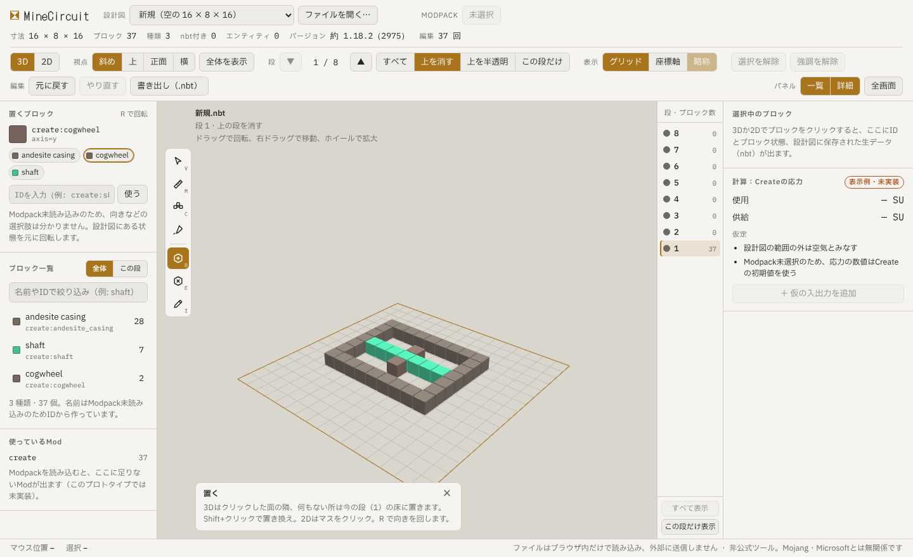

# MineCircuit 画面構成

作成日: 2026-10-19 / 仕様: [spec.md](spec.md) / 設計: [design.md](design.md)

UIプロトタイプ（[prototype/index.html](../prototype/index.html)）で確認した画面構成。計算は未実装で、計算欄は「表示例・未実装」と明記している。

## 全体の配置

| 場所 | 内容 |
| --- | --- |
| 上のバー1段目 | 設計図の選択・開く、Modpack、設計図の情報（寸法、ブロック数、種類、nbt付きの数、エンティティ数、バージョン、書き出してからの変更の回数） |
| 上のバー2段目 | 3D/2D、視点（斜め・上・正面・横、全体を表示）、段の移動と表示方法、補助表示（グリッド・座標軸・略称・回転）、選択と強調の解除、編集（元に戻す・やり直す・書き出し）、パネルの表示、全画面 |
| 左パネル | 置くブロック、ブロック一覧（全体／この段、検索、強調）、使っているMod |
| 表示部分 | 3D/2D表示。左上に縦のツールバー。左下に結果の表示（計測、お知らせ、書き出し） |
| 段の一覧 | 段ごとのブロック数と、段ごとの表示・非表示。「隠した段を戻す」 |
| 右パネル | 選択中のブロック（ID、位置、ブロック状態、生データのツリー）、計算結果（まとめ、問題、仮定。まとめはネット一覧で、ネットワークの行を押すとそのネットワークを強調する。問題はネットワーク全体のものを1件にまとめる。問題のうち警告は頭に「警告」と付け、3D・2Dの強調はしない） |
| 下の状態表示 | マウス位置、選択中のブロック |

画面の幅が900pxより狭いときは、上から「上のバー、表示部分、段の一覧、左パネル、右パネル」の順に1列に並べる。

## 段の一覧

基板設計ツールのレイヤー一覧を元にした。段ごとにブロック数を出し、左の丸で表示・非表示を切り替える。段の表示方法（すべて・上を消す・上を半透明・この段だけ）は上のバー2段目の選択だけで切り替え、段の一覧には同じ働きのボタンを置かない。段の一覧の丸は、段を1つずつ隠すためのもの。隠した段は表示方法によらず出さない。「隠した段を戻す」で、隠した段をまとめて表示に戻す（表示方法は変えない）。

## 2D表示と計測

2D表示は、選んだ段を真上から見たマス目。上が北（−Z）。1つ下の段を薄く出す。マスが大きいときは、ブロック名の略称を出す。

2D表示の動かし方。大きい設計図でも端まで見られるようにする。

- ホイール：マウスの位置を中心に拡大・縮小する
- 中ボタンでドラッグ、または空白キーを押したまま左ドラッグ：表示を動かす
- 上のバーの視点の「全体を表示」：設計図の段全体が入る大きさに戻す。別の設計図を開いたときも全体を表示にする

視点の「斜め・上・正面・横」は3D表示だけで使う。

計測ツールは、2つのブロックの座標の差、直線距離、軸に沿った距離、囲む範囲を出す。軸に沿った距離は、シャフトやベルトを引く長さの目安になる。

## 回転の表示

補助表示の「回転」を入れると、計算で回るとしたブロックを、速さの段階で色分けする。力（回転）がどこまで、どの速さで伝わっているかを、表示部分で確かめるためのもの。数値はプローブで1つずつ見る。

| 色 | 意味 |
| --- | --- |
| 灰 | 止まっている（動力源につながっていない、向きや速さが衝突している） |
| 緑 | 遅い（中速より遅い） |
| 青 | 中速（Create の設定の中速以上、高速より遅い。初期値では 30 RPM 以上） |
| 紫 | 高速（Create の設定の高速以上。初期値では 100 RPM 以上） |
| 赤 | 過負荷で止まっている（色は止まる前の速さではなく赤） |

- 3D：ブロックを色の箱で包み、回るブロックには、回る向きを示す輪の矢印を軸に垂直に付ける。輪は、軸の正の向きから見て、正の回転数なら反時計回りに見える（Create と同じ向き）
- 2D：マスを色で塗り、マスが大きいときは回転数を符号付きで書く。上下の軸で回るブロックは、上から見た向き（↺ ↻）も書く
- 表示部分の右下に色の凡例を出す
- 回して見せる動き（アニメーション）はしない

## 編集

- 2D：マスをクリックして置く。埋まったマスは置き換え
- 3D：クリックした面の隣に置く。何もない所は今の段の床に置く。Shift+クリックで置き換え
- 置くブロックは、左パネルの「置くブロック」の棚から選ぶ。棚はゲームのクリエイティブのインベントリのように、ブロックの絵（アイコン）を格子に並べたもの
  - 棚の上の「Mod」の欄で、棚に並べるものを選ぶ。選べるのは「この設計図」（設計図にあるブロック状態）と、Modpack を読んでいれば Mod（namespace）ごと。欄に Mod の名前か namespace の一部を入れると候補が出るので、クリックか ↑↓ と Enter で選ぶ。候補は、設計図で使っている Mod を先に、残りを名前順に並べる。Mod の中のブロックは表示名の順
  - 「ブロック」の欄に文字を入れると、選んでいる Mod の中を日本語名・英語名・ID の一部で絞り込む。`create:shaft[axis=y]` のような ID と状態は、Enter でそのまま使う
  - アイコンは、ブロックの見た目（モデルとテクスチャ）を斜め上から描いた小さな画像。見た目が分からないブロックや、テクスチャで描けないときは、ブロックの色と略称。名前と ID はマウスを重ねると出る
  - クリックすると置くブロックになり、置くツールに切り替わる。Mod から選んだときの状態（向きなど）は、ブロック状態の定義の最初の組み合わせ。状態は上の欄で取りうる値から選ぶ。R / Shift+R でも回せる
  - 棚や ID の入力で、Create の回るブロックの回転軸を決める状態（`axis`・`facing`）がなければ補う（`create:shaft` は `create:shaft[axis=y]`、`create:creative_motor` は `facing=north`）。書いた値は変えない
  - 補えない（`axis=w` のように値が読めない）ブロックも置けるが、置いた時点で「計算から外れます」と下の状態表示に出す
  - Modpack がないときは、「この設計図」と ID の入力だけ
  - スポイトで表示中のブロックから取ることもできる
  - ホットバーや「最近使ったもの」は持たない
- 置くとき、隣に回転でつながるブロック（Create のシャフト・歯車・モーターなど）があれば、つながる向きに自動で合わせる。シャフトの端にシャフトを置けば同じ軸、歯車の横に歯車を置けば噛み合う軸、モーターは軸をそのシャフトへ向ける。3D ではクリックした面の側を優先する。つながる相手がなければ、置くブロックの欄の向きのまま
- Alt を押しながら置くと、自動で合わせず、置くブロックの欄の向きのまま置く
- ゲームで置けない（置いても外れて落ちる）場所には置かせず、理由を下の状態表示に出す。置く前の見本は赤くなる。今入れている規則は Create の歯車だけ：大きい歯車の横（軸に垂直な4方向）には歯車を置けず、大きい歯車は小さい歯車の横に置けない（隣の軸がこちらを向いていれば置ける）。噛み合わせるときは斜めに置く。自動で向きを合わせるときは、置ける向きだけから選ぶ
- 置き方の補助（3D）：歯車を置くとき、歯車をクリックすると、ゲームの置き方の補助と同じく噛み合う位置に置く。大きさが違う歯車なら、クリックした点に近い側の斜めに同じ軸で。小さい歯車どうしなら、クリックした点に近い向きの横に同じ軸で。大きい歯車どうしなら、軸の向きに1つずらした斜めに、軸を直角にして。置ける位置がなければ、ふつうにクリックした面の隣に置く。歯車の真ん中の軸の部分をクリックしたときと、Alt を押しているときは補助を使わない。置く前の見本も補助の位置に出す
- R で選択中のブロックを回したとき、回した向きが置けない向きなら回さずに理由を出す
- 開いた設計図に規則に合わないブロックがあれば、計算結果の「問題」にその位置を出す
- 置いた段が隠れる表示のときは、その段へ自動で移る

### 書き出していない変更

- 上のバーの設計図の情報に「書き出してから n 回の変更」を出す。置く・消す・回す・範囲の操作・元に戻す・やり直すを、それぞれ1回と数える。変更がなければ「変更なし」
- 書き出し（.nbt）で保存できたら 0 に戻す。保存先を選ぶ画面でやめたときは戻さない。書き出しの途中にした変更は、書き出していない変更として残る
- 元に戻して書き出したときと同じ中身になっても、回数は 0 に戻さない
- 書き出していない変更があるとき、設計図を入れ替える前に確かめる
  - 「ファイルを開く…」とファイルのドロップ：ファイルを選んだあと、開く前に「書き出していない変更が n 回あります。続けると、この変更はなくなります。続けますか。」と確かめる。やめると今の設計図のまま
  - 「新規…」：作る画面に「書き出していない変更（n 回）はなくなります」と出し、「作る」を押したら入れ替える
  - Modpack の読み込みは設計図を入れ替えないので、確かめない
- ページを閉じる・再読み込みするときは、ブラウザの確認を出す（文はブラウザが決める）
- デスクトップ版でウィンドウを閉じるときは、「書き出していない変更が n 回あります。閉じると、この変更はなくなります。閉じますか。」と確かめる。やめると閉じない。閉じてよければ自分で閉じるため、Tauri の許可 `core:window:allow-destroy` を足した（#173）

## 範囲の選択と一括操作

範囲を選んで、まとめて消す・塗る・置き換える・動かす・回す・反転する・コピーして貼り付ける（#129）。どれも1回の「元に戻す」で戻る。

### 範囲を選ぶ

選択ツール（V）で選ぶ。範囲は箱（x・y・z の最小と最大）1つだけ。

- クリック：そのブロック1つを選ぶ（今までと同じ）。範囲は 1×1×1 の箱になる。空きマスをクリックすると選択を解除する
- Shift+クリック：最初にクリックしたブロック（起点）と、今クリックした所を角にした箱に広げる。段をまたいでよい（3D では別の段のブロックを、2D では段を変えてからクリックする）。空きマスも角にできる
- 2D でドラッグ：今の段の長方形を選ぶ。Shift+ドラッグで、起点の段から今の段までの高さにする
- Ctrl+A：設計図全体を選ぶ
- Esc：選択を解除する（貼り付けの途中なら、貼り付けをやめる）
- 選んでいる範囲は、3D では箱の線で、2D では範囲に入る段で長方形の線で示す。範囲の外の段にいるときは、2D の長方形を点線にする

### 右パネル「選択範囲」

2つ以上のブロックが入る範囲を選んでいるときに出す（1つのときは今の「選択中のブロック」）。

- 範囲の最小・最大の座標と大きさ。数を打って直せる（段は1始まりで出す）
- 中のブロックの数と、多い順の種類（上位5つ）
- ボタン：「消す」「置くブロックで塗る」「置き換え…」「左右反転（X）」「前後反転（Z）」「回す（右）」「回す（左）」「コピー」「切り取り」「複製」
- 置き換え：「置き換える物」（範囲の中にある状態から選ぶ）と「置く物」（今の置くブロック）を選んで実行する。生データは消える

### まとめて変える

| 操作 | キー | 内容 |
| --- | --- | --- |
| 消す | Delete | 範囲の中を空きにする |
| 塗る | F | 範囲の中を置くブロックにする。パネルで「空きだけ」を選べる（初期値は空きだけ）。生データは消える |
| 置き換え | － | パネルから。ある状態を置くブロックに変える。向きのプロパティ（`axis`・`facing` など）を置く物も持っていれば、元の向きを引き継ぐ |

### 動かす

範囲の中のブロックを、生データごと動かす。範囲も一緒に動く。

- 矢印キー：水平に1マス。2D では画面の上下左右（上が −Z）。3D では、画面の上下左右に一番近い x・z の向き
- Shift+PageUp / Shift+PageDown：上下に1段（PageUp / PageDown だけなら今までどおり段の移動）
- 行き先に範囲の外のブロックがあれば、動かさず「動かす先にブロックがあります（3 個）」と出す。重ねて上書きするときは Ctrl を押しながら動かす
- 設計図の外へはみ出すときは、設計図を広げる（下の「設計図の大きさ」）
- 範囲の中のエンティティ（額縁など）と、範囲の中のブロックに付けた仮の入出力も一緒に動く

### 回す・反転する

範囲を、範囲の中心のマス（中心が2つのマスの間なら小さい側のマス）を軸に回す・反転する。ブロックの向きのプロパティも、ゲームの回転・反転の規則で変える。

- R：上から見て右回りに 90°。Shift+R：左回りに 90°（範囲を選んでいないとき、範囲が1マスのときは、今までどおりブロックを回す・縦にする）。パネルの「回す（右）」「回す（左）」も同じ
- 反転はパネルのボタンから（左右反転は x の向きを逆に、前後反転は z の向きを逆に）。反転は範囲の中で写すので、範囲は動かない
- 回すと範囲の大きさの x と z が入れ替わる。軸のマスは動かないので、4回回すと元の位置に戻る。はみ出せば設計図を広げる。ほかのブロックに重なるときは、動かすときと同じく止めて理由を出す（Ctrl+R で上書き）
- 範囲の中のエンティティ（額縁など）は、位置と向きも回す。範囲の中のブロックに付けた仮の入出力は、位置と面を回す。選択範囲は回したあとの範囲になる
- 生データの中の座標（機械アームの行き先など）も、回転・反転に合わせて書き直す（Mod ごとの規則。docs/create-stress.md「回転・反転」）。範囲の外のブロックを指していたものは、回しても相手が一緒に動かないので、状態表示に「生データの座標を直せないブロックがあります（n 個）」と出す
- 縦（x・z の軸のまわり）の回転はしない

### コピー・切り取り・貼り付け

- Ctrl+C：範囲の中（ブロック・生データ・エンティティ）をアプリの中の切り抜きに写す。空きマスは写さない（貼り付けで空きにしない）
- Ctrl+X：写してから消す
- Ctrl+V：貼り付けの見本を出す。見本はマウスについて動き、置くときと同じく、3D はクリックした面の隣、2D は今の段のマスに、切り抜きの最小の角を合わせる。R / Shift+R で見本を回す。クリックで貼る。Esc でやめる
- 見本は、重なるブロックがあれば赤くし、クリックしても貼らない（Ctrl+クリックで上書き）
- 1回貼ったら見本を消す。続けて貼るときは、もう一度 Ctrl+V
- 見本を出している間は、今のツールの代わりに見本がクリックを受け取る。ツールを切り替えると貼り付けをやめる
- Ctrl+D：複製。範囲を写し、すぐ隣（x の正の向き）に貼る見本を出す
- 貼ったあとは、貼った所が新しい選択範囲になる
- 切り抜きは別の設計図を開いても残る（アプリを閉じると消える）。別の設計図に貼ると、Mod の違いはそのまま（足りない Mod の検出に出る）

### 設計図の大きさ

- 動かす・回す・貼り付けで設計図の外へはみ出すときは、はみ出す分だけ設計図を広げる。最小の角が負の向きにはみ出すときは、全体をずらして 0 から始まるようにする（座標が変わるので、状態表示で知らせる）
- 広げられるのは各辺 512 まで。超えるときは操作をやめて理由を出す
- .litematic でリージョンが2つ以上あるときは、範囲が入っているリージョンを広げる。ほかのリージョンに重なるときは、操作をやめて理由を出す
- 広げたあとの空きは、元に戻すと元の大きさに戻る。空きの端を詰める操作（「余白を詰める」）は後で足す

## ツール

表示部分の左上の縦のツールバー。回路図エディタのツールバーを元にした。

| ツール | キー | 内容 |
| --- | --- | --- |
| 選択 | V | ブロックの情報を右パネルに出す。Shift+クリック・2D のドラッグで範囲を選ぶ（「範囲の選択と一括操作」） |
| 計測 | M | 2つのブロックの距離を測る |
| つながり | C | 隣り合う同じ種類のブロックをまとめて強調する。回転や配管のつながりではない |
| プローブ | － | マウスの下のブロックの回転数と応力、運ぶブロックの輸送量、機械の処理時間（[create-throughput.md](create-throughput.md)）を、値の出どころ付きで右パネルに出す。クリックすると、回転でつながったブロック（ネットワーク）を青緑で強調する |
| 仮の入出力 | － | ブロックの面をクリックして、仮の動力源（回転数、供給）や仮の負荷（応力）、物の入口（アイテム、個/秒）を置く。同じ面をクリックすると選ぶ。右パネルの一覧で値・面・メモを変え、消す。3D・2Dに印（動力源は緑、負荷は橙、物の入口は青）を出す。物の入口のアイテムは、名前か ID を打って候補から選ぶ。計算結果とプローブでは、出どころを「仮の入出力」と出す |
| 置く | B | ブロックを置く・置き換える |
| 消す | E | ブロックを消す |
| スポイト | I | クリックしたブロックを「置くブロック」にする |

## キー操作

| キー | 操作 |
| --- | --- |
| V / M / C / B / E / I | ツールの切り替え |
| R | 水平に回す（north→east→south→west、軸は x↔z）。範囲なら右回りに 90° |
| Shift+R | 縦にする（軸 y、facing up/down）。範囲なら左回りに 90° |
| Ctrl+R / Ctrl+Shift+R | 範囲を回す。ほかのブロックに重なっても上書きする |
| Ctrl+Z / Ctrl+Y | 元に戻す / やり直す |
| Delete | 選択中のブロック（範囲）を消す |
| F | 範囲を置くブロックで塗る |
| 矢印キー | 範囲を水平に1マス動かす |
| Shift+PageUp / Shift+PageDown | 範囲を上下に1段動かす |
| Ctrl+A | 設計図全体を選ぶ |
| Ctrl+C / Ctrl+X / Ctrl+V | 範囲のコピー / 切り取り / 貼り付け |
| Ctrl+D | 範囲の複製 |
| G | グリッドの表示切り替え |
| PageUp / PageDown | 段の移動 |
| ホイール | 拡大・縮小（2D） |
| 空白キー＋左ドラッグ / 中ボタンでドラッグ | 表示を動かす（2D） |
| Esc | 選択の解除、貼り付けをやめる |

R / Shift+R は、2つ以上のマスの範囲を選んでいるときは（どのツールでも）、範囲を右・左に 90° 回す（「範囲の選択と一括操作」）。それ以外は、置くツールのときは置くブロックを回す。ほかのツールでは、選択中のブロックがあればそのブロックを（元に戻せる操作として）回し、なければ置くブロックを回す。回せる向きがなければ、下の状態表示に「このブロックには回せる向きがありません」と出す。Modpackを読んでいれば、そのブロックが取りうる値の範囲で回す。

## プロトタイプについて

- `prototype/index.html` をChromeかEdgeで開くと動く。Three.js を CDN から読み込むので、ネット接続が必要
- 例として入っている設計図は、コードで生成したデータ（小さな加工ラインのデモ、負荷テスト、新規）だけ。他人が作った設計図は含めない。デモの配置は見た目の例で、ゲームで動くことは確かめていない
- 書き出しは、`.nbt` を作って読み直し、配置と状態が一致するかの確認までは全環境で動く。保存はブラウザが保存先の選択に対応している場合だけ
- 計算、Modpackの読み込み、範囲操作は未実装（アプリの範囲操作は #129）
